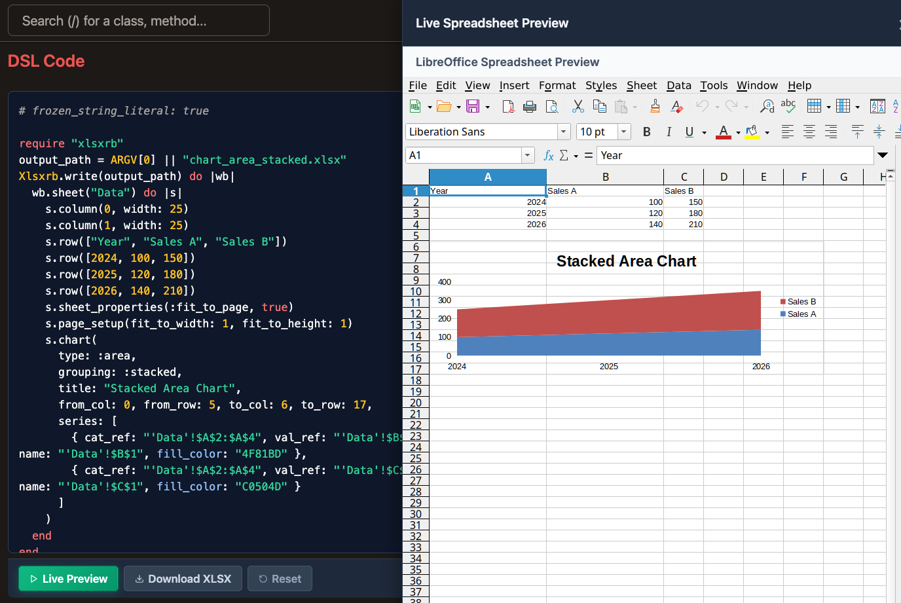
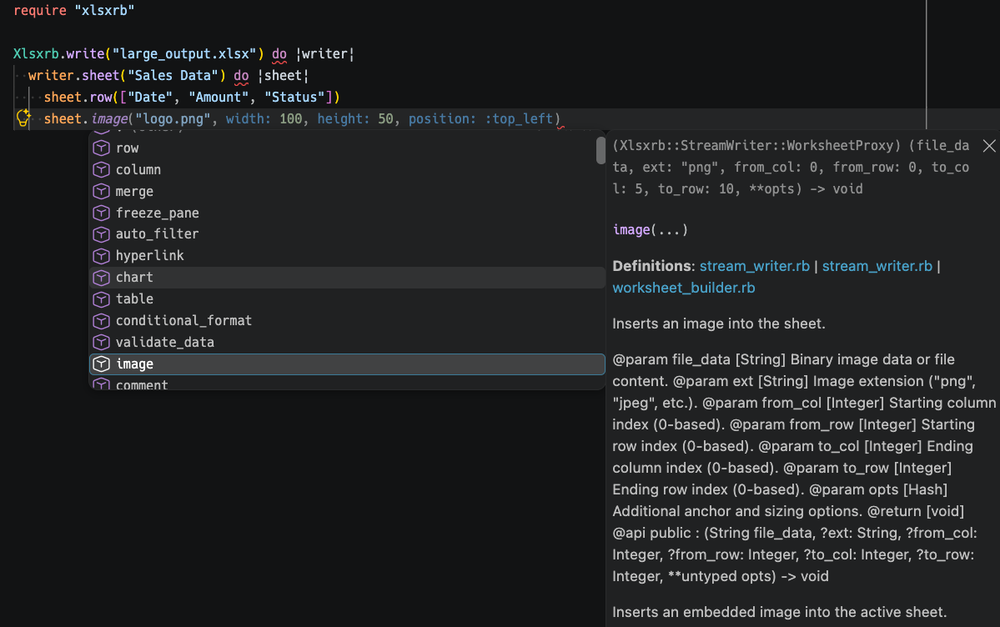
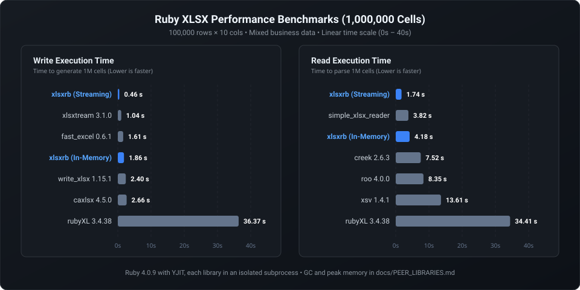

# Xlsxrb

A Ruby library for reading and writing XLSX files with streaming support.

Drop-in compatibility adapters for peer Ruby XLSX libraries are available at [xlsxrb-adapters](https://github.com/niku/xlsxrb-adapters).

## Motivation

The Ruby ecosystem has several XLSX libraries designed for specific tradeoffs:

| Library | Read | Write | Streaming | In-Memory |
| :--- | :---: | :---: | :---: | :---: |
| [roo](https://rubygems.org/gems/roo) | Yes | - | - | Yes |
| [creek](https://rubygems.org/gems/creek) | Yes | - | Yes | - |
| [xsv](https://rubygems.org/gems/xsv) | Yes | - | Yes | - |
| [simple_xlsx_reader](https://rubygems.org/gems/simple_xlsx_reader) | Yes | - | Yes | - |
| [caxlsx / axlsx](https://rubygems.org/gems/caxlsx) | - | Yes | - | Yes |
| [write_xlsx](https://rubygems.org/gems/write_xlsx) | - | Yes | - | Yes |
| [xlsxtream](https://rubygems.org/gems/xlsxtream) | - | Yes | Yes | - |
| [fast_excel](https://rubygems.org/gems/fast_excel) | - | Yes | Yes | - |
| [rubyXL](https://rubygems.org/gems/rubyXL) | Yes | Yes | - | Yes |
| [xlsxrb](https://github.com/niku/xlsxrb) | Yes | Yes | Yes | Yes |


These libraries make different architectural tradeoffs:
* Streaming Model: Writes or reads rows sequentially on-the-fly to maintain a low-memory footprint regardless of dataset size.
* In-Memory Model: Builds a complete document object model, offering flexible random access, cell updates, and document templates at the cost of memory usage on large spreadsheets.

Maintaining a gem that supports both reading and writing across streaming and in-memory models, alongside OOXML features and specification compatibility, involves significant ongoing maintenance overhead.

`xlsxrb` addresses this through automated workflows: AI coding agents handle routine maintenance tasks such as end-to-end testing, visual regression testing, schema compliance checks, and documentation synchronization, enabling sustainable maintenance of both streaming and in-memory architectures.

### Design Principles

- Zero Runtime Dependencies: Built strictly on the Ruby standard library and bundled gems (`zlib`, `rexml`, etc.) with zero third-party runtime dependencies.
- Streaming Support: Low-memory row streaming for reading and writing spreadsheets ($O(1)$ memory on reads; writes buffer unique shared strings).
- OpenXML Interoperability: Compliant with ISO/IEC 29500 (ECMA-376) and validated against the Microsoft [Open XML SDK](https://github.com/dotnet/Open-XML-SDK).
- AI-Assisted Maintenance: Uses AI coding agents for automated quality assurance and verification workflows. Operational guidelines are defined in [AGENTS.md](AGENTS.md).
- Ruby 3.4+: Requires Ruby 3.4 or higher.

### Autonomous Quality Assurance

To maintain its multi-layered QA suite (Steep static typing, 100% mutation kill rate across 51 subjects, ECMA-376 XSD validation, and $O(1)$ streaming memory) without high manual maintenance overhead, xlsxrb defines remediation workflows for AI coding agents ([AGENTS.md](AGENTS.md), [docs/QA_AGENTS.md](docs/QA_AGENTS.md)).

## Installation

```bash
bundle add xlsxrb
# Or without Bundler: gem install xlsxrb
```

Upgrading from 0.1.x: see [docs/UPGRADING-0.2.md](docs/UPGRADING-0.2.md) for removed APIs, their replacements, and changed defaults.

## Interactive Playground (WebAssembly)

Try `xlsxrb` directly in your browser without installing anything!

[Try the Live Demo / Interactive Playground](https://niku.github.io/xlsxrb/preview.html)

<p align="center">
  
</p>

You can also browse 80+ rendered visual examples across all features in the [Visual Examples Gallery](docs/visual/VisualGallery.md).

## Usage

### I/O Architecture Matrix

xlsxrb provides four canonical entry points organized along two axes:

| Axis | Streaming ($O(1)$ Memory) | In-Memory (Full Random Access) |
| :--- | :--- | :--- |
| Read / Input | `Xlsxrb.read(source) { \|sheet\| ... }` | `Xlsxrb.load(source) -> Elements::Workbook` |
| Write / Output | `Xlsxrb.write(dest) { \|writer\| ... }` | `Xlsxrb.build { \|builder\| ... } -> Elements::Workbook` |

---

### Streaming Read ($O(1)$ Memory)

Iterates rows sequentially without loading the full document into memory. Closes the underlying archive automatically upon block completion:

```ruby
require "xlsxrb"

Xlsxrb.read("large_file.xlsx") do |sheet|
  sheet.each_row do |row|
    row.each_cell do |cell|
      puts "#{cell.ref}: #{cell.value}"
    end
  end
end
```

### Streaming Write (Low Memory)

Pipes row and cell XML directly to the archive without buffering rows in memory:

```ruby
require "xlsxrb"

Xlsxrb.write("large_output.xlsx") do |writer|
  writer.sheet("Sales Data") do |sheet|
    sheet.row(["Date", "Amount", "Status"])
    sheet.row([Date.today, 100, true])
    sheet.column(0, width: 15.5)
  end
end
```

### In-Memory Load (Full Random Access)

Parses the workbook into an immutable document model (`Elements::Workbook`) and immediately closes the underlying file:

```ruby
require "xlsxrb"

wb = Xlsxrb.load("workbook.xlsx")
sheet = wb["Sheet1"]

puts sheet["A1"].value
puts sheet.page_setup.orientation
puts sheet.hyperlinks["B2"].url
```

### In-Memory Build (Document Creation)

Constructs an in-memory `Elements::Workbook` using the declarative builder DSL:

```ruby
require "xlsxrb"

wb = Xlsxrb.build do |b|
  b.sheet("Report") do |s|
    s.row(["Metric", "Value"])
    s.row(["Users", 1000])
  end
end

# Save to file or get binary string for Rails send_data
Xlsxrb.write("report.xlsx", wb)
binary_data = Xlsxrb.write(wb)
```

---

### Constant-Memory Streaming Transformation

To transform or filter data from an existing spreadsheet, stream rows from reader to writer in $O(1)$ memory:

```ruby
require "xlsxrb"

Xlsxrb.write("output.xlsx") do |out_wb|
  out_wb.sheet("Processed") do |out_sheet|
    Xlsxrb.read("input.xlsx") do |in_sheet|
      in_sheet.each_row do |row|
        # type_cast: true turns date-formatted cells into Date/Time (so they are not
        # scaled as numbers) and keeps empty cells as nil in their column.
        out_sheet.row(row.values(type_cast: true).map { |v| v.is_a?(Numeric) ? v * 1.1 : v })
      end
    end
  end
end
```

This copies cell values only. Styles, number formats other than dates, formulas, merged cells, and column widths are not carried over; set them on the writer if the output needs them.

---

### Template Migration & AI Code Generation

> [!NOTE]
> `Xlsxrb.modify` was removed in 0.2.0 in favor of `Xlsxrb.read` -> `Xlsxrb.write` and `Xlsxrb.load`. Runtime data transformations are handled with streaming pipelines (`Xlsxrb.read` -> `Xlsxrb.write`), while template-based report generation is performed by converting templates into declarative `Xlsxrb.write` DSL scripts.

To migrate an existing Excel template (`template.xlsx`) into reproducible Ruby code, inspect the template structure with `Xlsxrb.load` and provide it to an AI coding assistant:

```ruby
require "xlsxrb"

wb = Xlsxrb.load("template.xlsx")
sheet = wb.sheets.first

# Inspect layout, formulas, and column widths
puts "Columns: #{sheet.columns.map { |c| [c.index, c.width] }}"
puts "Merged: #{sheet.merged_cells}"
puts "Formulas: #{sheet.rows.flat_map(&:cells).select(&:formula?).map { |c| [c.ref, c.formula] }}"
```

**Recommended AI Prompt for Template Migration:**
> "Convert this Excel template into an `Xlsxrb.write` builder script using xlsxrb DSL methods (`row`, `column`, `merge`, `style`, `formula`). Ensure cell styles, column widths, number formats, and formulas match the inspected template layout."

### Password Protection & Encryption ([MS-OFFCRYPTO])

Natively supports reading and writing encrypted XLSX files (Standard & Agile Encryption) with zero external C-extensions:

```ruby
require "xlsxrb"

# Write password-protected file
Xlsxrb.write("confidential.xlsx", password: "SecretPassword123") do |writer|
  writer.sheet("Financials") { |sheet| sheet.row(["Assets", 5_000_000]) }
end

# Read password-protected file
Xlsxrb.read("confidential.xlsx", password: "SecretPassword123") do |sheet|
  sheet.each_row { |row| puts row.cells.map(&:value) }
end
```

### Date and Time Handling

Excel stores dates and times as serial numbers (days since 1900, with the time of day as the fraction) and marks them as dates only through the cell's number format. `cell.value` returns that serial number as an Integer or Float. To get dates back:

```ruby
Xlsxrb.read("input.xlsx") do |sheet|
  sheet.each_row do |row|
    row.values(type_cast: true) # => ["Due", #<Date: 2026-01-02>, 2026-01-02 03:04:05 UTC]

    row.cells.each do |cell|
      next unless cell.date_format?

      cell.to_date # => Date
      cell.to_time # => Time in UTC
    end
  end
end
```

When writing, `Date`, `Time`, and `DateTime` values get a date or date-time number format automatically, also when the cell has a style without its own `number_format`.

Serial numbers carry no timezone, so `to_time` returns the wall-clock time as UTC. To interpret it in an application timezone (such as JST or America/New_York), build a local time from its components:

```ruby
t = cell.to_time

# With ActiveSupport / Rails:
local_time = Time.zone.local(t.year, t.month, t.day, t.hour, t.min, t.sec)

# With Ruby standard library:
local_time = Time.local(t.year, t.month, t.day, t.hour, t.min, t.sec)
```

### IDE Autocompletion & Ruby LSP Support

Includes a native Ruby LSP Add-on and full RBS signatures for zero-configuration method autocompletion and hover documentation in VS Code and other editors:

<p align="center">
  
</p>

## Feature Support & ECMA-376 Compliance

`xlsxrb` supports standard spreadsheet features:
* Layout & Structure: Formulas, Hyperlinks, Merge Cells, Freeze/Split Panes, Page Setup, Auto Filters, Data Validations, Sheet/Workbook Protection.
* Styling & Media: Rich Text, Cell Styles & Fills, Conditional Formatting (color scales, data bars), Embedded Images, Charts (Line, Bar, Pie, Radar, Scatter).

For full details, see [docs/SPEC_SOURCES.md](docs/SPEC_SOURCES.md).

## Benchmarks

Benchmark processing 1,000,000 cells (100,000 rows × 10 cols) across popular Ruby gems, with YJIT enabled for every library (Rails 7.2 and later enable YJIT by default):

<p align="center">
  
</p>

For detailed metrics (peak memory, GC count, mean/median times) and architectural tradeoffs (SST vs. Inline Strings), see [docs/PEER_LIBRARIES.md](docs/PEER_LIBRARIES.md).

To reproduce locally: `RUBY_YJIT_ENABLE=1 ruby benchmark.rb 100000 10`

## Quality Assurance & Testing

Verified by a multi-layered QA architecture:
* Microsoft Open XML SDK Validation: Validates generated OOXML structures against Microsoft's official SDK.
* Visual Regression Testing (VRT): Headless LibreOffice Calc pixel-by-pixel rendering checks.
* Contract & Round-Trip Tests: Verifies parity between Streaming and In-Memory APIs and round-trip read/write accuracy.
* Mutation Testing (Mutant): 100% mutant kill rate (2,549/2,549 mutations across 51 subjects) on pure algorithms, predicates, and coordinates ([docs/MUTATION_TESTING.md](docs/MUTATION_TESTING.md)).
* Security & DoS Protection: Formula injection mitigation and ZIP bomb protection.

For full architectural details, see [docs/ARCHITECTURE.md](docs/ARCHITECTURE.md) and [docs/QUALITY_ASSURANCE.md](docs/QUALITY_ASSURANCE.md).

## Development & Contributing

See [docs/DEVELOPMENT.md](docs/DEVELOPMENT.md) for local setup (Dev Container support), testing workflows, and contribution guidelines.

## License

The gem is available as open source under the terms of the [MIT License](https://opensource.org/licenses/MIT).

