# Visual Examples Gallery

This gallery showcases `xlsxrb` DSL usage side-by-side with the visual rendering in LibreOffice Calc.

> [!TIP]
> **Interactive WebAssembly Playground**: Experiment with `xlsxrb` directly in your browser. Open the [WebAssembly Live Playground](../preview.html) to run Ruby code and preview spreadsheets rendered in LibreOffice Calc without local installation.

[◄ Back to README](../../README.md)

## Capability Overview

### Fundamentals & Data Types

<table>
<thead>
<tr>
<th align="left">Feature</th>
<th align="center">Visual Preview</th>
<th align="center">Actions</th>
</tr>
</thead>
<tbody>
<tr>
<td>Basic Data</td>
<td align="center"></td>
<td align="center"><a href="#basic-data">View Code</a><br/><a href="../preview.html?example=quick_start">Live Playground</a></td>
</tr>
<tr>
<td>Cell Numbers</td>
<td align="center"></td>
<td align="center"><a href="#cell-numbers">View Code</a><br/><a href="../preview.html?example=number_formats">Live Playground</a></td>
</tr>
<tr>
<td>Cell Dates</td>
<td align="center"></td>
<td align="center"><a href="#cell-dates">View Code</a><br/><a href="../preview.html?example=number_formats">Live Playground</a></td>
</tr>
<tr>
<td>Cell Times</td>
<td align="center"></td>
<td align="center"><a href="#cell-times">View Code</a><br/><a href="../preview.html">Live Playground</a></td>
</tr>
<tr>
<td>Cell Booleans</td>
<td align="center"></td>
<td align="center"><a href="#cell-booleans">View Code</a><br/><a href="../preview.html">Live Playground</a></td>
</tr>
<tr>
<td>Cell Rich Text</td>
<td align="center">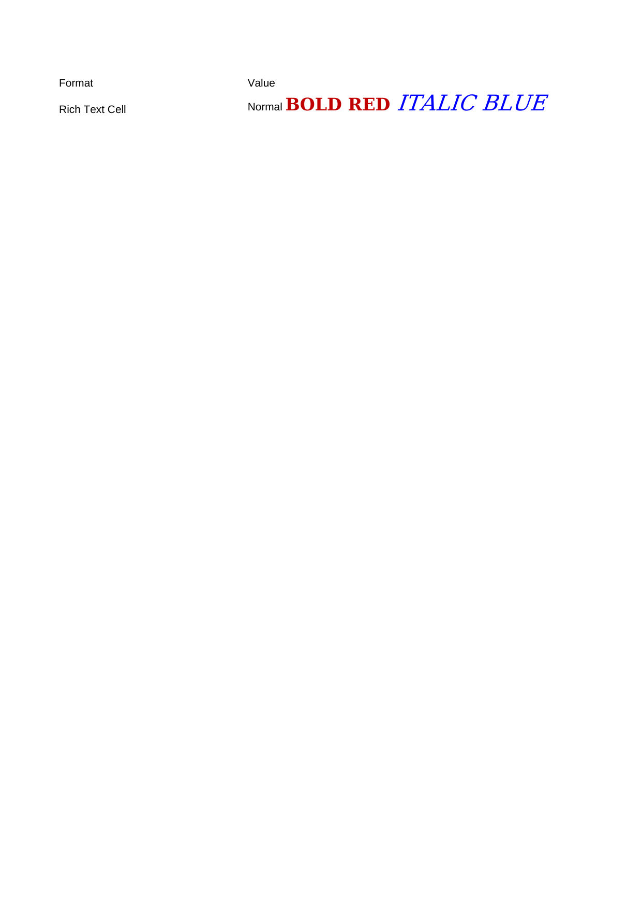</td>
<td align="center"><a href="#cell-rich-text">View Code</a><br/><a href="../preview.html">Live Playground</a></td>
</tr>
<tr>
<td>Cell Formulas</td>
<td align="center">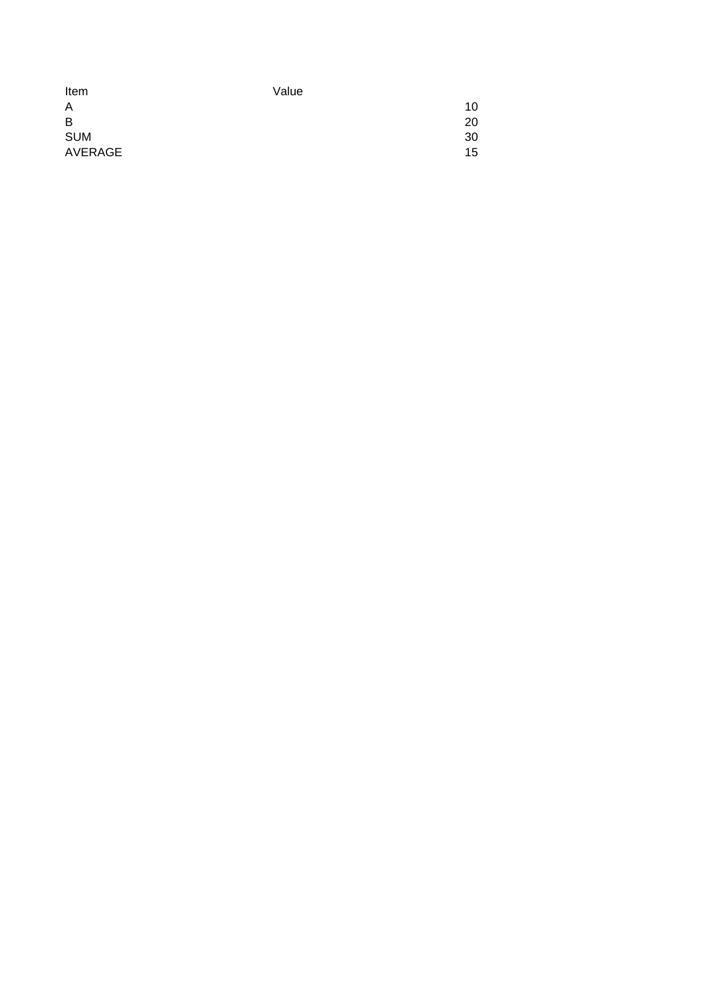</td>
<td align="center"><a href="#cell-formulas">View Code</a><br/><a href="../preview.html">Live Playground</a></td>
</tr>
<tr>
<td>Japanese Text</td>
<td align="center"></td>
<td align="center"><a href="#japanese-text">View Code</a><br/><a href="../preview.html?example=japanese_text">Live Playground</a></td>
</tr>
</tbody>
</table>

### Styles & Formatting

<table>
<thead>
<tr>
<th align="left">Feature</th>
<th align="center">Visual Preview</th>
<th align="center">Actions</th>
</tr>
</thead>
<tbody>
<tr>
<td>Styles Fonts Fills</td>
<td align="center"></td>
<td align="center"><a href="#styles-fonts-fills">View Code</a><br/><a href="../preview.html?example=styles_borders">Live Playground</a></td>
</tr>
<tr>
<td>Column Styles</td>
<td align="center"></td>
<td align="center"><a href="#column-styles">View Code</a><br/><a href="../preview.html">Live Playground</a></td>
</tr>
<tr>
<td>Fonts</td>
<td align="center">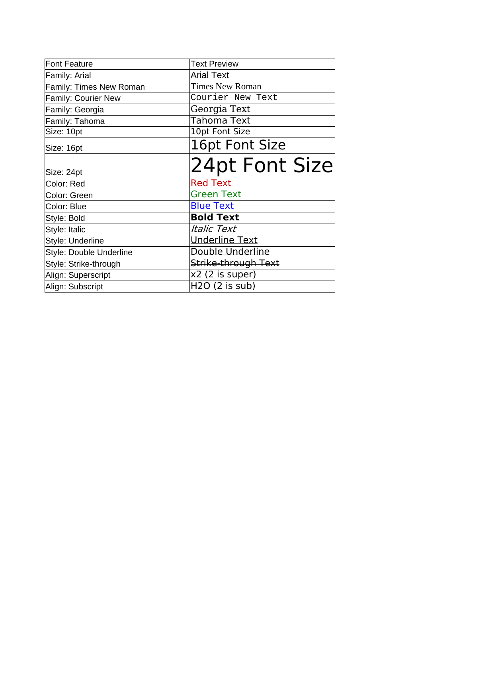</td>
<td align="center"><a href="#fonts">View Code</a><br/><a href="../preview.html">Live Playground</a></td>
</tr>
<tr>
<td>Borders</td>
<td align="center">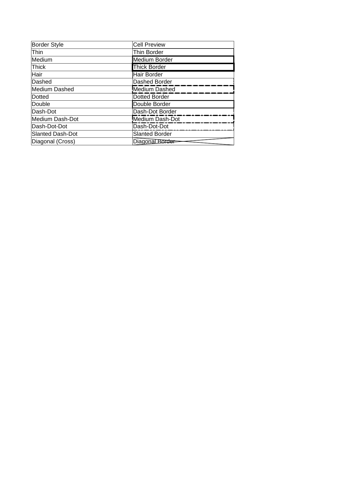</td>
<td align="center"><a href="#borders">View Code</a><br/><a href="../preview.html?example=styles_borders">Live Playground</a></td>
</tr>
<tr>
<td>Fill Solid Colors</td>
<td align="center">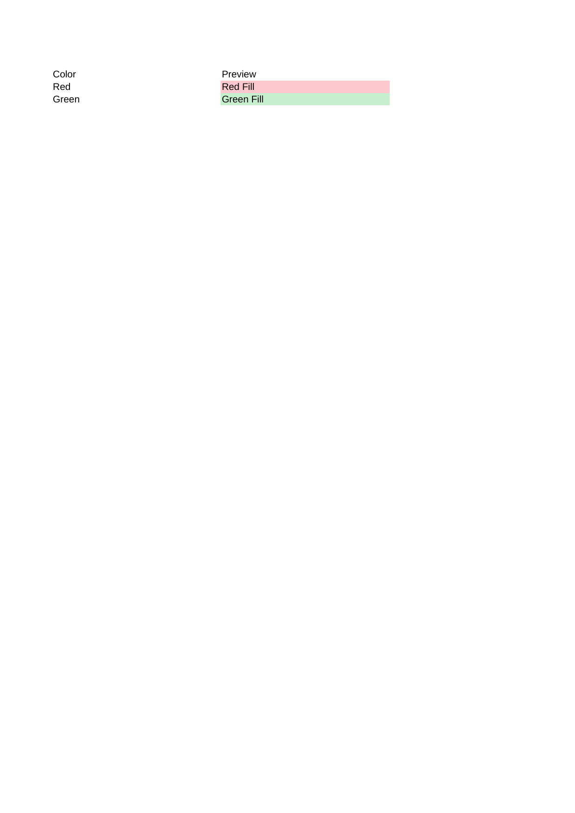</td>
<td align="center"><a href="#fill-solid-colors">View Code</a><br/><a href="../preview.html">Live Playground</a></td>
</tr>
<tr>
<td>Fill Patterns</td>
<td align="center"></td>
<td align="center"><a href="#fill-patterns">View Code</a><br/><a href="../preview.html">Live Playground</a></td>
</tr>
<tr>
<td>Fill Gradients</td>
<td align="center"></td>
<td align="center"><a href="#fill-gradients">View Code</a><br/><a href="../preview.html">Live Playground</a></td>
</tr>
<tr>
<td>Sheet Tab Colors</td>
<td align="center"></td>
<td align="center"><a href="#sheet-tab-colors">View Code</a><br/><a href="../preview.html">Live Playground</a></td>
</tr>
</tbody>
</table>

### Alignment & Layout

<table>
<thead>
<tr>
<th align="left">Feature</th>
<th align="center">Visual Preview</th>
<th align="center">Actions</th>
</tr>
</thead>
<tbody>
<tr>
<td>Align Horizontal</td>
<td align="center"></td>
<td align="center"><a href="#align-horizontal">View Code</a><br/><a href="../preview.html">Live Playground</a></td>
</tr>
<tr>
<td>Align Horizontal Fill</td>
<td align="center"></td>
<td align="center"><a href="#align-horizontal-fill">View Code</a><br/><a href="../preview.html">Live Playground</a></td>
</tr>
<tr>
<td>Align Horizontal Justify</td>
<td align="center"></td>
<td align="center"><a href="#align-horizontal-justify">View Code</a><br/><a href="../preview.html">Live Playground</a></td>
</tr>
<tr>
<td>Align Vertical</td>
<td align="center"></td>
<td align="center"><a href="#align-vertical">View Code</a><br/><a href="../preview.html">Live Playground</a></td>
</tr>
<tr>
<td>Align Text Wrap</td>
<td align="center"></td>
<td align="center"><a href="#align-text-wrap">View Code</a><br/><a href="../preview.html">Live Playground</a></td>
</tr>
<tr>
<td>Align Text Rotation</td>
<td align="center"></td>
<td align="center"><a href="#align-text-rotation">View Code</a><br/><a href="../preview.html">Live Playground</a></td>
</tr>
<tr>
<td>Align Indent</td>
<td align="center"></td>
<td align="center"><a href="#align-indent">View Code</a><br/><a href="../preview.html">Live Playground</a></td>
</tr>
<tr>
<td>Col Widths</td>
<td align="center"></td>
<td align="center"><a href="#col-widths">View Code</a><br/><a href="../preview.html">Live Playground</a></td>
</tr>
<tr>
<td>Col Width Tall</td>
<td align="center"></td>
<td align="center"><a href="#col-width-tall">View Code</a><br/><a href="../preview.html">Live Playground</a></td>
</tr>
<tr>
<td>Row Heights</td>
<td align="center"></td>
<td align="center"><a href="#row-heights">View Code</a><br/><a href="../preview.html">Live Playground</a></td>
</tr>
<tr>
<td>Row Height Tall</td>
<td align="center"></td>
<td align="center"><a href="#row-height-tall">View Code</a><br/><a href="../preview.html">Live Playground</a></td>
</tr>
<tr>
<td>Merge Freeze</td>
<td align="center"></td>
<td align="center"><a href="#merge-freeze">View Code</a><br/><a href="../preview.html">Live Playground</a></td>
</tr>
<tr>
<td>Col Grouping</td>
<td align="center"></td>
<td align="center"><a href="#col-grouping">View Code</a><br/><a href="../preview.html">Live Playground</a></td>
</tr>
<tr>
<td>Row Grouping</td>
<td align="center"></td>
<td align="center"><a href="#row-grouping">View Code</a><br/><a href="../preview.html">Live Playground</a></td>
</tr>
</tbody>
</table>

### Number Formats & Currencies

<table>
<thead>
<tr>
<th align="left">Feature</th>
<th align="center">Visual Preview</th>
<th align="center">Actions</th>
</tr>
</thead>
<tbody>
<tr>
<td>Cell Num Currency Jpy</td>
<td align="center"></td>
<td align="center"><a href="#cell-num-currency-jpy">View Code</a><br/><a href="../preview.html?example=number_formats">Live Playground</a></td>
</tr>
<tr>
<td>Cell Num Percent Decimals</td>
<td align="center"></td>
<td align="center"><a href="#cell-num-percent-decimals">View Code</a><br/><a href="../preview.html">Live Playground</a></td>
</tr>
<tr>
<td>Cell Num Scientific</td>
<td align="center"></td>
<td align="center"><a href="#cell-num-scientific">View Code</a><br/><a href="../preview.html">Live Playground</a></td>
</tr>
<tr>
<td>Cell Num Fractions</td>
<td align="center">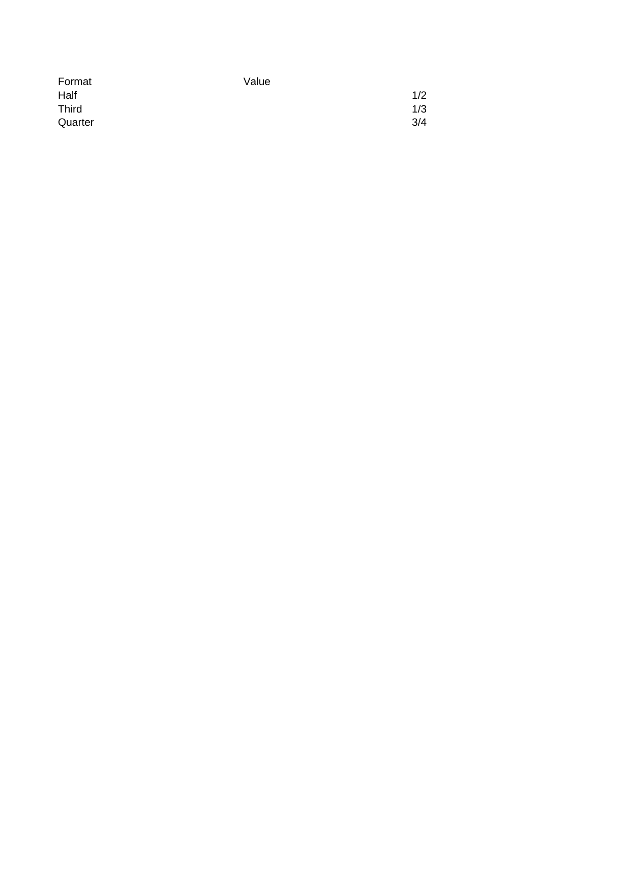</td>
<td align="center"><a href="#cell-num-fractions">View Code</a><br/><a href="../preview.html">Live Playground</a></td>
</tr>
<tr>
<td>Cell Num Custom Colors</td>
<td align="center"></td>
<td align="center"><a href="#cell-num-custom-colors">View Code</a><br/><a href="../preview.html">Live Playground</a></td>
</tr>
</tbody>
</table>

### Conditional Formatting

<table>
<thead>
<tr>
<th align="left">Feature</th>
<th align="center">Visual Preview</th>
<th align="center">Actions</th>
</tr>
</thead>
<tbody>
<tr>
<td>Conditional Formatting</td>
<td align="center"></td>
<td align="center"><a href="#conditional-formatting">View Code</a><br/><a href="../preview.html?example=conditional_formatting">Live Playground</a></td>
</tr>
<tr>
<td>Cf Color Scale</td>
<td align="center"></td>
<td align="center"><a href="#cf-color-scale">View Code</a><br/><a href="../preview.html">Live Playground</a></td>
</tr>
<tr>
<td>Cf Data Bar</td>
<td align="center"></td>
<td align="center"><a href="#cf-data-bar">View Code</a><br/><a href="../preview.html">Live Playground</a></td>
</tr>
<tr>
<td>Cf Icon Set</td>
<td align="center"></td>
<td align="center"><a href="#cf-icon-set">View Code</a><br/><a href="../preview.html">Live Playground</a></td>
</tr>
<tr>
<td>Cf Cell Greater Than</td>
<td align="center"></td>
<td align="center"><a href="#cf-cell-greater-than">View Code</a><br/><a href="../preview.html">Live Playground</a></td>
</tr>
<tr>
<td>Cf Cell Less Than</td>
<td align="center"></td>
<td align="center"><a href="#cf-cell-less-than">View Code</a><br/><a href="../preview.html">Live Playground</a></td>
</tr>
<tr>
<td>Cf Cell Equal To</td>
<td align="center"></td>
<td align="center"><a href="#cf-cell-equal-to">View Code</a><br/><a href="../preview.html">Live Playground</a></td>
</tr>
<tr>
<td>Cf Cell Between</td>
<td align="center"></td>
<td align="center"><a href="#cf-cell-between">View Code</a><br/><a href="../preview.html">Live Playground</a></td>
</tr>
<tr>
<td>Cf Cell Greater Equal</td>
<td align="center"></td>
<td align="center"><a href="#cf-cell-greater-equal">View Code</a><br/><a href="../preview.html">Live Playground</a></td>
</tr>
<tr>
<td>Cf Contains Text</td>
<td align="center"></td>
<td align="center"><a href="#cf-contains-text">View Code</a><br/><a href="../preview.html">Live Playground</a></td>
</tr>
<tr>
<td>Cf Begins With</td>
<td align="center"></td>
<td align="center"><a href="#cf-begins-with">View Code</a><br/><a href="../preview.html">Live Playground</a></td>
</tr>
<tr>
<td>Cf Ends With</td>
<td align="center"></td>
<td align="center"><a href="#cf-ends-with">View Code</a><br/><a href="../preview.html">Live Playground</a></td>
</tr>
<tr>
<td>Cf Expression Formula</td>
<td align="center"></td>
<td align="center"><a href="#cf-expression-formula">View Code</a><br/><a href="../preview.html">Live Playground</a></td>
</tr>
</tbody>
</table>

### Charts & Sparklines

<table>
<thead>
<tr>
<th align="left">Feature</th>
<th align="center">Visual Preview</th>
<th align="center">Actions</th>
</tr>
</thead>
<tbody>
<tr>
<td>Chart Bar</td>
<td align="center">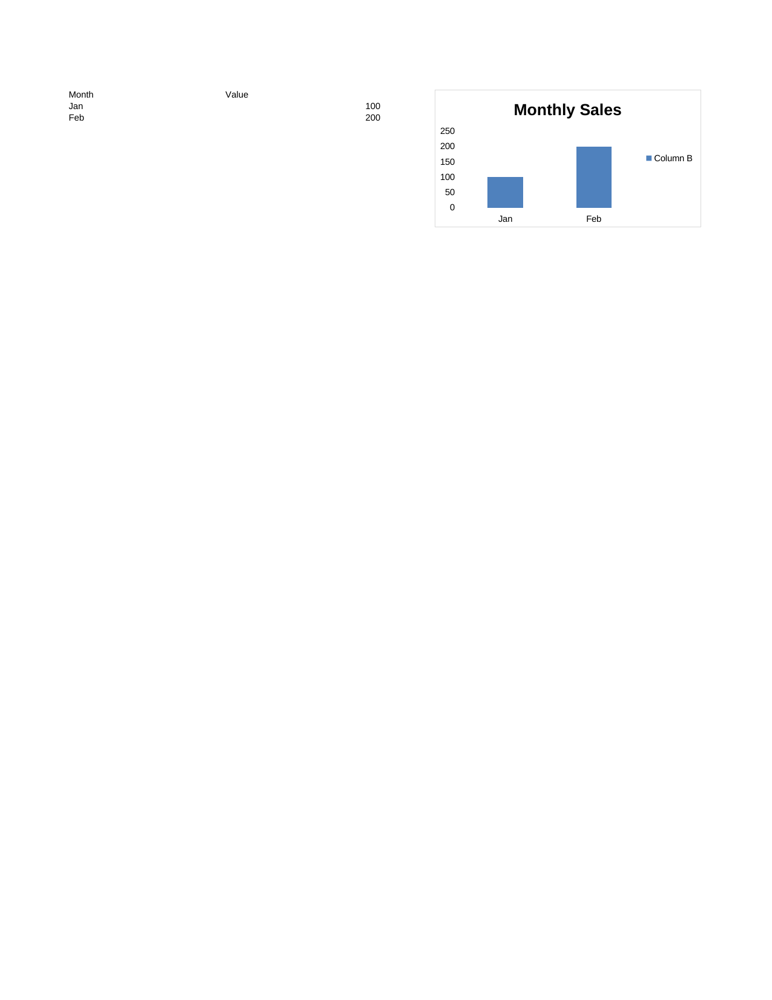</td>
<td align="center"><a href="#chart-bar">View Code</a><br/><a href="../preview.html?example=chart_bar">Live Playground</a></td>
</tr>
<tr>
<td>Chart Bar Stacked</td>
<td align="center">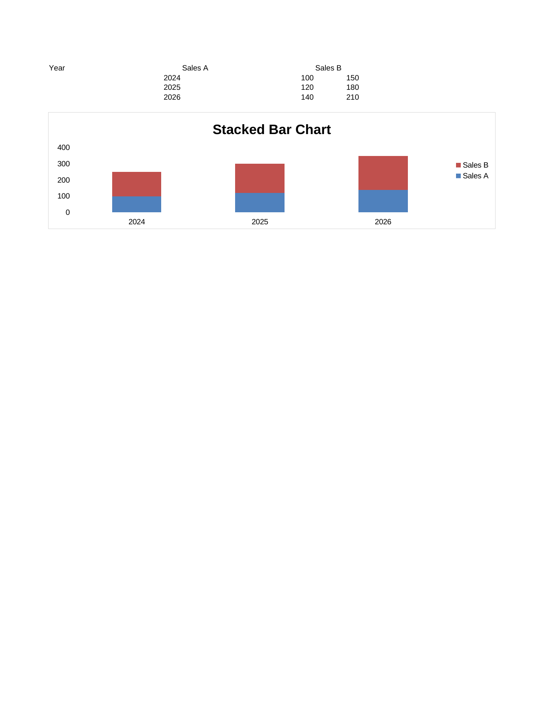</td>
<td align="center"><a href="#chart-bar-stacked">View Code</a><br/><a href="../preview.html">Live Playground</a></td>
</tr>
<tr>
<td>Chart Bar Percent Stacked</td>
<td align="center">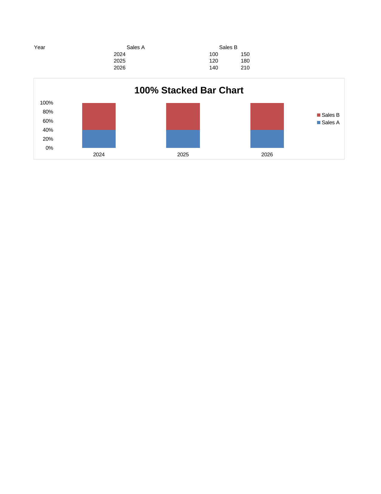</td>
<td align="center"><a href="#chart-bar-percent-stacked">View Code</a><br/><a href="../preview.html">Live Playground</a></td>
</tr>
<tr>
<td>Chart Line</td>
<td align="center"></td>
<td align="center"><a href="#chart-line">View Code</a><br/><a href="../preview.html?example=chart_line">Live Playground</a></td>
</tr>
<tr>
<td>Chart Line Stacked</td>
<td align="center">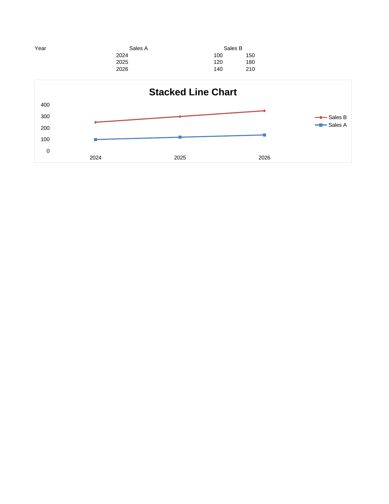</td>
<td align="center"><a href="#chart-line-stacked">View Code</a><br/><a href="../preview.html">Live Playground</a></td>
</tr>
<tr>
<td>Chart Area</td>
<td align="center"></td>
<td align="center"><a href="#chart-area">View Code</a><br/><a href="../preview.html">Live Playground</a></td>
</tr>
<tr>
<td>Chart Area Stacked</td>
<td align="center">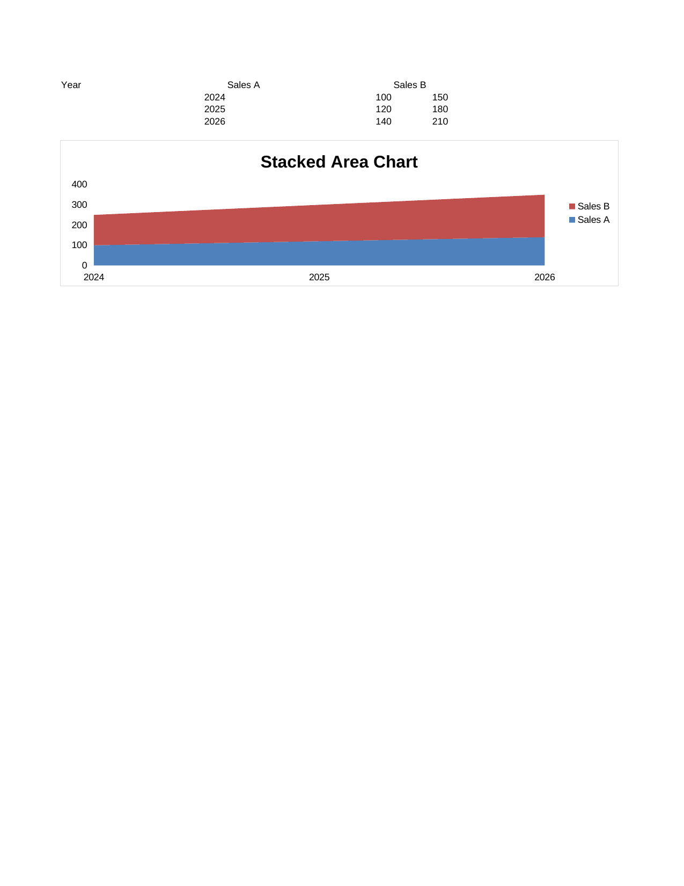</td>
<td align="center"><a href="#chart-area-stacked">View Code</a><br/><a href="../preview.html">Live Playground</a></td>
</tr>
<tr>
<td>Chart Pie</td>
<td align="center">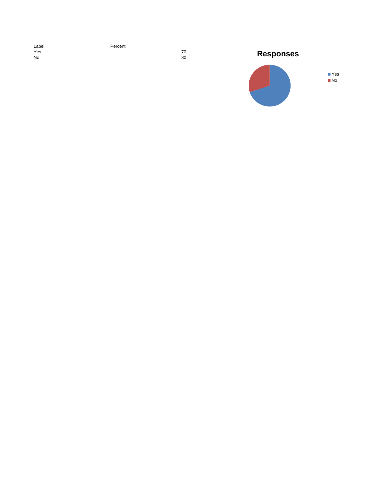</td>
<td align="center"><a href="#chart-pie">View Code</a><br/><a href="../preview.html?example=chart_pie">Live Playground</a></td>
</tr>
<tr>
<td>Chart Doughnut</td>
<td align="center">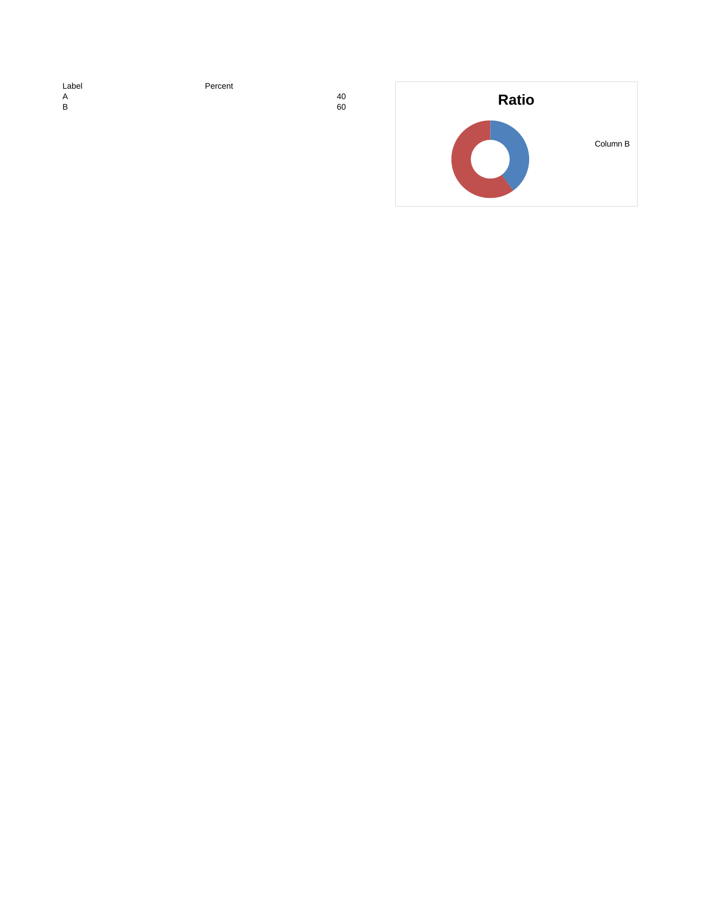</td>
<td align="center"><a href="#chart-doughnut">View Code</a><br/><a href="../preview.html">Live Playground</a></td>
</tr>
<tr>
<td>Chart Scatter</td>
<td align="center"></td>
<td align="center"><a href="#chart-scatter">View Code</a><br/><a href="../preview.html">Live Playground</a></td>
</tr>
<tr>
<td>Chart Radar</td>
<td align="center">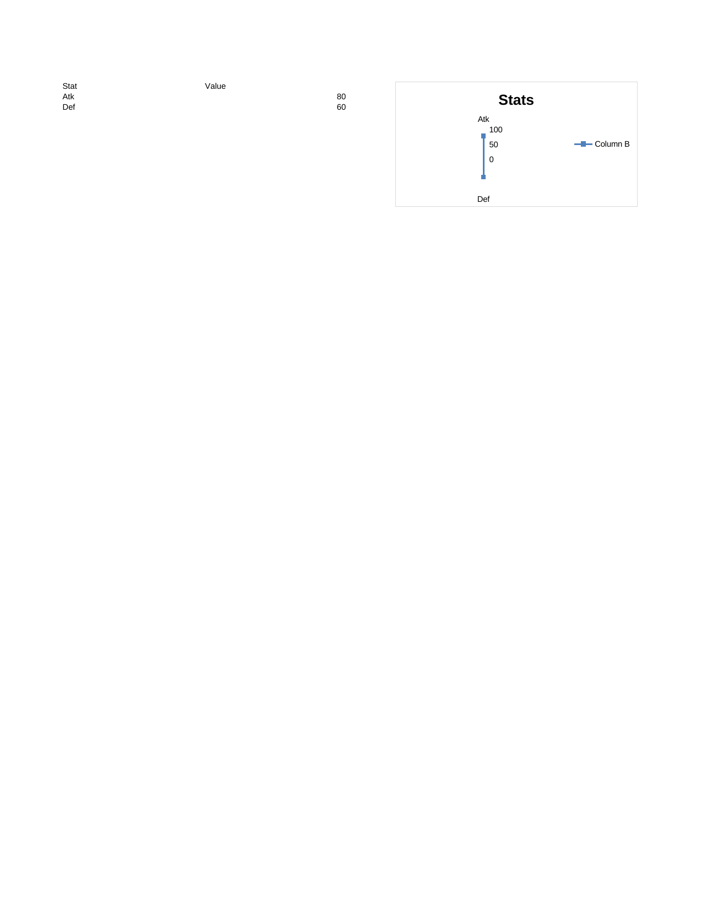</td>
<td align="center"><a href="#chart-radar">View Code</a><br/><a href="../preview.html">Live Playground</a></td>
</tr>
<tr>
<td>Sparkline Line</td>
<td align="center"></td>
<td align="center"><a href="#sparkline-line">View Code</a><br/><a href="../preview.html">Live Playground</a></td>
</tr>
<tr>
<td>Sparkline Column</td>
<td align="center"></td>
<td align="center"><a href="#sparkline-column">View Code</a><br/><a href="../preview.html">Live Playground</a></td>
</tr>
</tbody>
</table>

### Tables, Shapes & Pivot

<table>
<thead>
<tr>
<th align="left">Feature</th>
<th align="center">Visual Preview</th>
<th align="center">Actions</th>
</tr>
</thead>
<tbody>
<tr>
<td>Table Styles</td>
<td align="center"></td>
<td align="center"><a href="#table-styles">View Code</a><br/><a href="../preview.html?example=table_styles">Live Playground</a></td>
</tr>
<tr>
<td>Pivot Table</td>
<td align="center">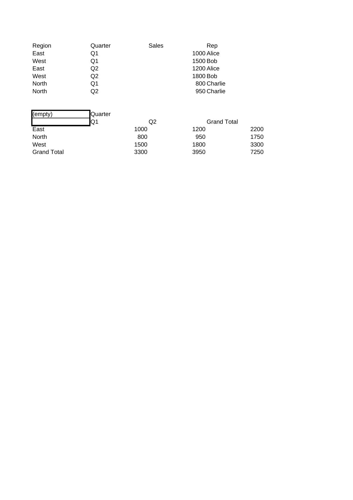</td>
<td align="center"><a href="#pivot-table">View Code</a><br/><a href="../preview.html">Live Playground</a></td>
</tr>
<tr>
<td>Drawing Shapes</td>
<td align="center"></td>
<td align="center"><a href="#drawing-shapes">View Code</a><br/><a href="../preview.html">Live Playground</a></td>
</tr>
<tr>
<td>Embedded Images</td>
<td align="center"></td>
<td align="center"><a href="#embedded-images">View Code</a><br/><a href="../preview.html">Live Playground</a></td>
</tr>
</tbody>
</table>

### Page Setup & Printing

<table>
<thead>
<tr>
<th align="left">Feature</th>
<th align="center">Visual Preview</th>
<th align="center">Actions</th>
</tr>
</thead>
<tbody>
<tr>
<td>Page Orientation Landscape</td>
<td align="center"></td>
<td align="center"><a href="#page-orientation-landscape">View Code</a><br/><a href="../preview.html">Live Playground</a></td>
</tr>
<tr>
<td>Page Paper Size A3</td>
<td align="center"></td>
<td align="center"><a href="#page-paper-size-a3">View Code</a><br/><a href="../preview.html">Live Playground</a></td>
</tr>
<tr>
<td>Page Margins Narrow</td>
<td align="center"></td>
<td align="center"><a href="#page-margins-narrow">View Code</a><br/><a href="../preview.html">Live Playground</a></td>
</tr>
<tr>
<td>Page Margins Wide</td>
<td align="center"></td>
<td align="center"><a href="#page-margins-wide">View Code</a><br/><a href="../preview.html">Live Playground</a></td>
</tr>
<tr>
<td>Page Header Footer</td>
<td align="center">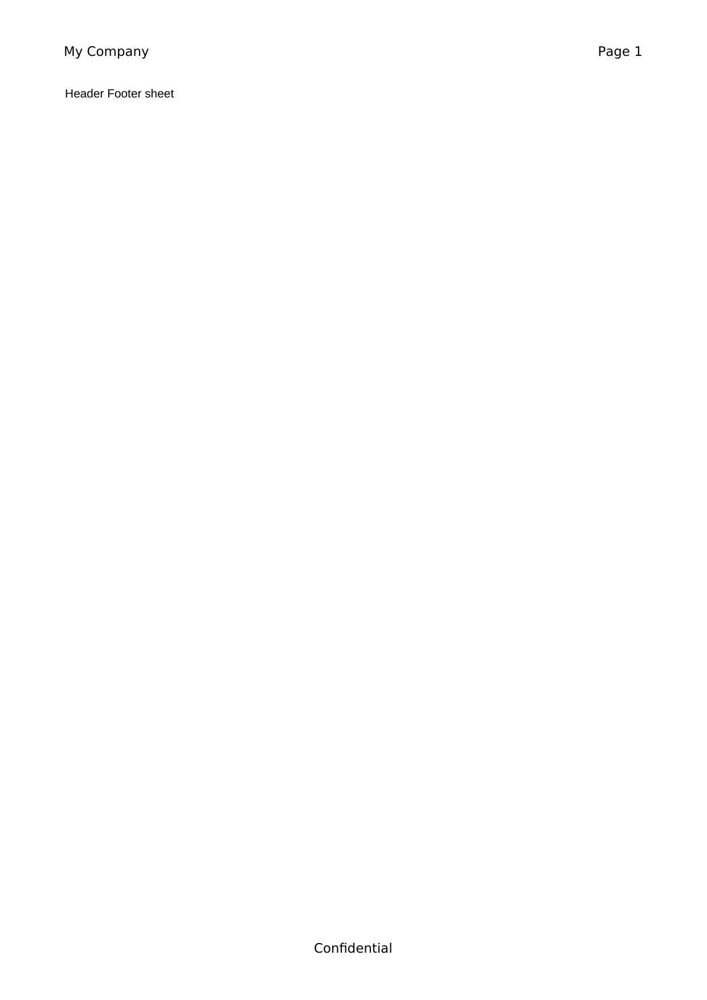</td>
<td align="center"><a href="#page-header-footer">View Code</a><br/><a href="../preview.html">Live Playground</a></td>
</tr>
<tr>
<td>Page Grid Lines Print</td>
<td align="center"></td>
<td align="center"><a href="#page-grid-lines-print">View Code</a><br/><a href="../preview.html">Live Playground</a></td>
</tr>
<tr>
<td>Page Headings Print</td>
<td align="center"></td>
<td align="center"><a href="#page-headings-print">View Code</a><br/><a href="../preview.html">Live Playground</a></td>
</tr>
<tr>
<td>Page Repeat Rows</td>
<td align="center">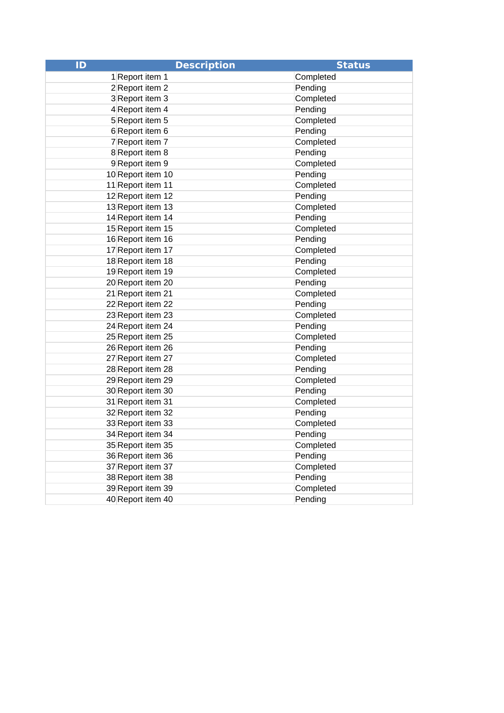</td>
<td align="center"><a href="#page-repeat-rows">View Code</a><br/><a href="../preview.html">Live Playground</a></td>
</tr>
</tbody>
</table>

### Interactive & Sheet Features

<table>
<thead>
<tr>
<th align="left">Feature</th>
<th align="center">Visual Preview</th>
<th align="center">Actions</th>
</tr>
</thead>
<tbody>
<tr>
<td>Hyperlinks</td>
<td align="center"></td>
<td align="center"><a href="#hyperlinks">View Code</a><br/><a href="../preview.html?example=hyperlinks">Live Playground</a></td>
</tr>
<tr>
<td>Sheet Protection</td>
<td align="center"></td>
<td align="center"><a href="#sheet-protection">View Code</a><br/><a href="../preview.html">Live Playground</a></td>
</tr>
<tr>
<td>Interactive Autofilter</td>
<td align="center"></td>
<td align="center"><a href="#interactive-autofilter">View Code</a><br/><a href="../preview.html">Live Playground</a></td>
</tr>
<tr>
<td>Interactive Comments</td>
<td align="center"></td>
<td align="center"><a href="#interactive-comments">View Code</a><br/><a href="../preview.html">Live Playground</a></td>
</tr>
<tr>
<td>Interactive Validation List</td>
<td align="center"></td>
<td align="center"><a href="#interactive-validation-list">View Code</a><br/><a href="../preview.html">Live Playground</a></td>
</tr>
<tr>
<td>Interactive Validation Range</td>
<td align="center"></td>
<td align="center"><a href="#interactive-validation-range">View Code</a><br/><a href="../preview.html">Live Playground</a></td>
</tr>
<tr>
<td>Interactive Validation Date</td>
<td align="center"></td>
<td align="center"><a href="#interactive-validation-date">View Code</a><br/><a href="../preview.html">Live Playground</a></td>
</tr>
<tr>
<td>Interactive Validation Time</td>
<td align="center"></td>
<td align="center"><a href="#interactive-validation-time">View Code</a><br/><a href="../preview.html">Live Playground</a></td>
</tr>
<tr>
<td>Interactive Validation Text Length</td>
<td align="center"></td>
<td align="center"><a href="#interactive-validation-text-length">View Code</a><br/><a href="../preview.html">Live Playground</a></td>
</tr>
<tr>
<td>Interactive Validation Custom</td>
<td align="center"></td>
<td align="center"><a href="#interactive-validation-custom">View Code</a><br/><a href="../preview.html">Live Playground</a></td>
</tr>
<tr>
<td>View Show Grid Lines</td>
<td align="center"></td>
<td align="center"><a href="#view-show-grid-lines">View Code</a><br/><a href="../preview.html">Live Playground</a></td>
</tr>
<tr>
<td>View Zoom Scale</td>
<td align="center"></td>
<td align="center"><a href="#view-zoom-scale">View Code</a><br/><a href="../preview.html">Live Playground</a></td>
</tr>
<tr>
<td>Workbook Three Sheets</td>
<td align="center"></td>
<td align="center"><a href="#workbook-three-sheets">View Code</a><br/><a href="../preview.html">Live Playground</a></td>
</tr>
</tbody>
</table>

---

## Basic Data

[👉 Run and edit in Live Playground](../preview.html?example=quick_start)

Demonstrates simple tabular data writing with basic Ruby types (Strings, Numbers, Dates, Booleans).

### Rendered Output (LibreOffice Calc)

<div></div>

### DSL Code

```ruby
# frozen_string_literal: true

require "xlsxrb"
require "date"

output_path = ARGV[0] || "basic_data.xlsx"

Xlsxrb.write(output_path) do |wb|
  wb.style("currency") { |style| style.number_format("$#,##0.00") }
  wb.style("date") { |style| style.number_format("yyyy-mm-dd") }
  wb.sheet("Basic Data") do |sheet|
    sheet.sheet_properties(:fit_to_page, true)
    sheet.page_setup(fit_to_width: 1, fit_to_height: 1)
    sheet.column(0, width: 25)
    sheet.column(1, width: 25)
    sheet.row(%w[Product Qty Price Date Active])
    sheet.row(["Gadget A", 10, 99.99, Date.new(2026, 1, 15), true], styles: { 2 => "currency", 3 => "date" })
    sheet.row(["Widget B", 5, 49.50, Date.new(2026, 2, 20), false], styles: { 2 => "currency", 3 => "date" })
  end
end
```

<hr/>

## Cell Numbers

[👉 Run and edit in Live Playground](../preview.html?example=number_formats)

Demonstrates custom formatting for integers, floating point numbers, currencies, and percentages.

### Rendered Output (LibreOffice Calc)

<div></div>

### DSL Code

```ruby
# frozen_string_literal: true

require "xlsxrb"
output_path = ARGV[0] || "cell_numbers.xlsx"
Xlsxrb.write(output_path) do |wb|
  wb.style("currency") { |s| s.num_fmt("$#,##0.00") }
  wb.style("percent") { |s| s.num_fmt("0.0%") }
  wb.sheet("Numbers") do |s|
    s.column(0, width: 25)
    s.column(1, width: 25)
    s.row(%w[Format Value])
    s.row(["Integer", 12_345])
    s.row(["Float", 123.456])
    s.row(["Currency", 1234.5], styles: { 1 => "currency" })
    s.row(["Percentage", 0.85], styles: { 1 => "percent" })
  end
end
```

<hr/>

## Cell Dates

[👉 Run and edit in Live Playground](../preview.html?example=number_formats)

Demonstrates dates serialized natively and formatted with standard or custom format strings.

### Rendered Output (LibreOffice Calc)

<div></div>

### DSL Code

```ruby
# frozen_string_literal: true

require "xlsxrb"
require "date"
output_path = ARGV[0] || "cell_dates.xlsx"
Xlsxrb.write(output_path) do |wb|
  wb.style("custom_date") { |s| s.num_fmt("yyyy-mm-dd") }
  wb.sheet("Dates") do |s|
    s.column(0, width: 25)
    s.column(1, width: 25)
    s.row(["Format", "Date Value"])
    s.row(["Default Date", Date.new(2026, 7, 1)])
    s.row(["Formatted Date", Date.new(2026, 12, 25)], styles: { 1 => "custom_date" })
  end
end
```

<hr/>

## Cell Times

[👉 Run and edit in Live Playground](../preview.html)

Demonstrates timestamp values serialized natively and formatted showing hours, minutes, and seconds.

### Rendered Output (LibreOffice Calc)

<div></div>

### DSL Code

```ruby
# frozen_string_literal: true

require "xlsxrb"
require "time"
output_path = ARGV[0] || "cell_times.xlsx"
Xlsxrb.write(output_path) do |wb|
  wb.style("time_fmt") { |s| s.num_fmt("hh:mm:ss") }
  wb.sheet("Times") do |s|
    s.column(0, width: 25)
    s.column(1, width: 25)
    s.row(["Format", "Time Value"])
    s.row(["DateTime", Time.new(2026, 7, 1, 12, 34, 56)])
    s.row(["Time Only", Time.new(2026, 7, 1, 9, 15, 0)], styles: { 1 => "time_fmt" })
  end
end
```

<hr/>

## Cell Booleans

[👉 Run and edit in Live Playground](../preview.html)

Demonstrates boolean values serialized and rendered.

### Rendered Output (LibreOffice Calc)

<div></div>

### DSL Code

```ruby
# frozen_string_literal: true

require "xlsxrb"
output_path = ARGV[0] || "cell_booleans.xlsx"
Xlsxrb.write(output_path) do |wb|
  wb.sheet("Booleans") do |s|
    s.column(0, width: 25)
    s.column(1, width: 25)
    s.row(["Label", "Boolean Value"])
    s.row(["Is Active", true])
    s.row(["Is Pending", false])
  end
end
```

<hr/>

## Cell Rich Text

[👉 Run and edit in Live Playground](../preview.html)

Demonstrates Rich Text cells with multiple font weights, styles, and colors in a single cell.

### Rendered Output (LibreOffice Calc)

<div></div>

### DSL Code

```ruby
# frozen_string_literal: true

require "xlsxrb"
output_path = ARGV[0] || "cell_rich_text.xlsx"
Xlsxrb.write(output_path) do |wb|
  rt = Xlsxrb.rich_text(
    { text: "Normal " },
    { text: "BOLD RED ", font: { bold: true, color: "FFC00000", sz: 16 } },
    { text: "ITALIC BLUE", font: { italic: true, color: :blue, sz: 20 } }
  )
  wb.sheet("Rich Text") do |s|
    s.column(0, width: 25)
    s.column(1, width: 25)
    s.row(%w[Format Value])
    s.row(["Rich Text Cell", rt])
  end
end
```

<hr/>

## Cell Formulas

[👉 Run and edit in Live Playground](../preview.html)

Demonstrates standard spreadsheet calculations and formulas (SUM, AVERAGE).

### Rendered Output (LibreOffice Calc)

<div></div>

### DSL Code

```ruby
# frozen_string_literal: true

require "xlsxrb"
output_path = ARGV[0] || "cell_formulas.xlsx"
Xlsxrb.write(output_path) do |wb|
  wb.sheet("Formulas") do |s|
    s.column(0, width: 25)
    s.column(1, width: 25)
    s.row(%w[Item Value])
    s.row(["A", 10])
    s.row(["B", 20])
    s.row(["SUM", Xlsxrb.formula("SUM(B2:B3)", cached_value: 30)])
    s.row(["AVERAGE", Xlsxrb.formula("AVERAGE(B2:B3)", cached_value: 15)])
  end
end
```

<hr/>

## Japanese Text

[👉 Run and edit in Live Playground](../preview.html?example=japanese_text)

Demonstrates writing multi-byte Japanese text and setting appropriate Japanese font names (e.g., Noto Sans CJK JP).

### Rendered Output (LibreOffice Calc)

<div></div>

### DSL Code

```ruby
# frozen_string_literal: true

require "xlsxrb"

output_path = ARGV[0] || "japanese_text.xlsx"

Xlsxrb.write(output_path) do |wb|
  wb.style("ja_font") do |style|
    style.font_name("Noto Sans CJK JP").size(12)
  end

  wb.sheet("Japanese") do |s|
    s.column(0, width: 25)
    s.column(1, width: 25)
    s.row(%w[日本語ラベル 値], styles: { 0 => "ja_font", 1 => "ja_font" })
    s.row(["売上", 12_500], styles: { 0 => "ja_font" })
  end
end
```

<hr/>

## Styles Fonts Fills

[👉 Run and edit in Live Playground](../preview.html?example=styles_borders)

Demonstrates cell formatting, including custom font sizing, bold/italic text, custom text colors, and background fill colors.

### Rendered Output (LibreOffice Calc)

<div></div>

### DSL Code

```ruby
# frozen_string_literal: true

require "xlsxrb"

output_path = ARGV[0] || "styles_fonts_fills.xlsx"

Xlsxrb.write(output_path) do |wb|
  wb.style("header") do |style|
    style.bold.size(14).font_color("FFFFFFFF").fill_color("FF4F81BD")
  end

  wb.style("highlight") do |style|
    style.italic.font_color("FFC00000").fill_color("FFFFFF00")
  end

  wb.sheet("Styles") do |sheet|
    sheet.column(0, width: 25)
    sheet.column(1, width: 25)
    sheet.row(["Header 1", "Header 2"], styles: "header")
    sheet.row(["Normal Text", "Highlighted Text"], styles: [nil, "highlight"])
  end
end
```

<hr/>

## Column Styles

[👉 Run and edit in Live Playground](../preview.html)

Demonstrates setting default cell styles and number formats at the column level so data rows automatically inherit them without per-cell style mapping.

### Rendered Output (LibreOffice Calc)

<div></div>

### DSL Code

```ruby
# frozen_string_literal: true

require "xlsxrb"
require "date"

output_path = ARGV[0] || "column_styles.xlsx"

Xlsxrb.write(output_path) do |wb|
  wb.style(:header, bold: true, fill_color: "D9E1F2", align_horizontal: :center)
  wb.style(:currency, number_format: "$#,##0.00", align_horizontal: :right)
  wb.style(:date, number_format: "yyyy-mm-dd", align_horizontal: :center)
  wb.style(:percent, number_format: "0.0%", align_horizontal: :right)

  wb.sheet("Column Styles") do |s|
    # Configure default styles per column so data rows do not need per-cell style mapping
    s.column(0, width: 20)
    s.column(1, width: 16, style: :date)
    s.column(2, width: 16, style: :currency)
    s.column(3, width: 14, style: :percent)

    s.row(%w[Item Date Price Margin], styles: :header)
    s.row(["Widget A", Date.new(2026, 4, 1), 1250.0, 0.25])
    s.row(["Gadget B", Date.new(2026, 5, 15), 340.5, 0.18])
    s.row(["Tool C", Date.new(2026, 6, 20), 89.99, 0.42])
  end
end
```

<hr/>

## Fonts

[👉 Run and edit in Live Playground](../preview.html)

Demonstrates cell fonts properties (Arial, Georgia, Courier New, Times New Roman, Tahoma, sizes 10pt/16pt/24pt, red/green/blue colors, bold/italic/underline/double underline/strike-through styles, superscript/subscript).

### Rendered Output (LibreOffice Calc)

<div></div>

### DSL Code

```ruby
# frozen_string_literal: true

require "xlsxrb"

output_path = ARGV[0] || "fonts.xlsx"

Xlsxrb.write(output_path) do |wb|
  # Font Families (using nested hash options)
  wb.style("f_arial", font: { name: "Arial" })
  wb.style("f_times", font: { name: "Times New Roman" })
  wb.style("f_courier", font: { name: "Courier New" })
  wb.style("f_georgia", font: { name: "Georgia" })
  wb.style("f_tahoma", font: { name: "Tahoma" })

  # Font Sizes
  wb.style("sz_10", font: { size: 10 })
  wb.style("sz_16", font: { size: 16 })
  wb.style("sz_24", font: { size: 24 })

  # Font Colors
  wb.style("c_red", font: { color: "FFC00000" })
  wb.style("c_green", font: { color: "FF008000" })
  wb.style("c_blue", font: { color: :blue })

  # Font Styles
  wb.style("bold", font: { bold: true })
  wb.style("italic", font: { italic: true })
  wb.style("underline", font: { underline: true })
  wb.style("double_underline", font: { underline: "double" })
  wb.style("strike", font: { strike: true })

  # Vertical Alignment (Subscript / Superscript)
  wb.style("superscript", font: { vert_align: "superscript" })
  wb.style("subscript", font: { vert_align: "subscript" })

  wb.style("header", font: { bold: true, color: :white }, fill: { color: "FF4F81BD" })
  wb.style("bg_light", fill: { color: "FFDCE6F1" })

  wb.sheet("Fonts") do |s|
    s.column(0, width: 25)
    s.column(1, width: 35)

    s.row(["Font Feature", "Text Preview"], styles: "header")

    s.row(["Family: Arial", "Arial Text"], styles: %w[bg_light f_arial])
    s.row(["Family: Times New Roman", "Times New Roman"], styles: [nil, "f_times"])
    s.row(["Family: Courier New", "Courier New Text"], styles: %w[bg_light f_courier])
    s.row(["Family: Georgia", "Georgia Text"], styles: [nil, "f_georgia"])
    s.row(["Family: Tahoma", "Tahoma Text"], styles: %w[bg_light f_tahoma])

    s.row(["Size: 10pt", "10pt Font Size"], styles: [nil, "sz_10"])
    s.row(["Size: 16pt", "16pt Font Size"], styles: %w[bg_light sz_16])
    s.row(["Size: 24pt", "24pt Font Size"], styles: [nil, "sz_24"])

    s.row(["Color: Red", "Red Text"], styles: %w[bg_light c_red])
    s.row(["Color: Green", "Green Text"], styles: [nil, "c_green"])
    s.row(["Color: Blue", "Blue Text"], styles: %w[bg_light c_blue])

    s.row(["Style: Bold", "Bold Text"], styles: [nil, "bold"])
    s.row(["Style: Italic", "Italic Text"], styles: %w[bg_light italic])
    s.row(["Style: Underline", "Underline Text"], styles: [nil, "underline"])
    s.row(["Style: Double Underline", "Double Underline"], styles: %w[bg_light double_underline])
    s.row(["Style: Strike-through", "Strike-through Text"], styles: [nil, "strike"])

    s.row(["Align: Superscript", "x2 (2 is super)"], styles: %w[bg_light superscript])
    s.row(["Align: Subscript", "H2O (2 is sub)"], styles: [nil, "subscript"])
  end
end
```

<hr/>

## Borders

[👉 Run and edit in Live Playground](../preview.html?example=styles_borders)

Demonstrates border styles (thin, medium, thick, hair, dashed, medium dashed, dotted, double, dash-dot, medium dash-dot, dash-dot-dot, slanted, and diagonal cross borders) applied to cell ranges.

### Rendered Output (LibreOffice Calc)

<div></div>

### DSL Code

```ruby
# frozen_string_literal: true

require "xlsxrb"

output_path = ARGV[0] || "borders.xlsx"

Xlsxrb.write(output_path) do |wb|
  wb.style("thin") { |s| s.border_all(style: "thin", color: "FF000000") }
  wb.style("medium") { |s| s.border_all(style: "medium", color: "FF000000") }
  wb.style("thick") { |s| s.border_all(style: "thick", color: "FF000000") }
  wb.style("hair") { |s| s.border_all(style: "hair", color: "FF000000") }
  wb.style("dashed") { |s| s.border_all(style: "dashed", color: "FF000000") }
  wb.style("medium_dashed") { |s| s.border_all(style: "mediumDashed", color: "FF000000") }
  wb.style("dotted") { |s| s.border_all(style: "dotted", color: "FF000000") }
  wb.style("double") { |s| s.border_all(style: "double", color: "FF000000") }
  wb.style("dash_dot") { |s| s.border_all(style: "dashDot", color: "FF000000") }
  wb.style("medium_dash_dot") { |s| s.border_all(style: "mediumDashDot", color: "FF000000") }
  wb.style("dash_dot_dot") { |s| s.border_all(style: "dashDotDot", color: "FF000000") }
  wb.style("slanted") { |s| s.border_all(style: "slantedDashDot", color: "FF000000") }
  wb.style("diagonal") { |s| s.border_diagonal(style: "thin", color: "FF000000", up: true, down: true) }

  wb.sheet("Borders") do |s|
    s.column(0, width: 25)
    s.column(1, width: 25)
    s.print_options(:grid_lines, true)

    s.row(["Border Style", "Cell Preview"])
    s.row(["Thin", "Thin Border"], styles: { 1 => "thin" })
    s.row(["Medium", "Medium Border"], styles: { 1 => "medium" })
    s.row(["Thick", "Thick Border"], styles: { 1 => "thick" })
    s.row(["Hair", "Hair Border"], styles: { 1 => "hair" })
    s.row(["Dashed", "Dashed Border"], styles: { 1 => "dashed" })
    s.row(["Medium Dashed", "Medium Dashed"], styles: { 1 => "medium_dashed" })
    s.row(["Dotted", "Dotted Border"], styles: { 1 => "dotted" })
    s.row(["Double", "Double Border"], styles: { 1 => "double" })
    s.row(["Dash-Dot", "Dash-Dot Border"], styles: { 1 => "dash_dot" })
    s.row(["Medium Dash-Dot", "Medium Dash-Dot"], styles: { 1 => "medium_dash_dot" })
    s.row(%w[Dash-Dot-Dot Dash-Dot-Dot], styles: { 1 => "dash_dot_dot" })
    s.row(["Slanted Dash-Dot", "Slanted Border"], styles: { 1 => "slanted" })
    s.row(["Diagonal (Cross)", "Diagonal Border"], styles: { 1 => "diagonal" })
  end
end

# Read check
```

<hr/>

## Fill Solid Colors

[👉 Run and edit in Live Playground](../preview.html)

Demonstrates solid cell background fill colors.

### Rendered Output (LibreOffice Calc)

<div></div>

### DSL Code

```ruby
# frozen_string_literal: true

require "xlsxrb"
output_path = ARGV[0] || "fill_solid_colors.xlsx"
Xlsxrb.write(output_path) do |wb|
  wb.style("red_fill") { |s| s.fill_color("FFFFC7CE") }
  wb.style("green_fill") { |s| s.fill_color("FFC6EFCE") }
  wb.sheet("Fills") do |s|
    s.column(0, width: 25)
    s.column(1, width: 25)
    s.row(%w[Color Preview])
    s.row(["Red", "Red Fill"], styles: { 1 => "red_fill" })
    s.row(["Green", "Green Fill"], styles: { 1 => "green_fill" })
  end
end
```

<hr/>

## Fill Patterns

[👉 Run and edit in Live Playground](../preview.html)

Demonstrates standard pattern fills (darkGray, darkGrid) in cell backgrounds.

### Rendered Output (LibreOffice Calc)

<div></div>

### DSL Code

```ruby
# frozen_string_literal: true

require "xlsxrb"
output_path = ARGV[0] || "fill_patterns.xlsx"
Xlsxrb.write(output_path) do |wb|
  wb.style("dark_gray") { |s| s.fill(pattern: "darkGray", fg_color: "FFC0C0C0", bg_color: "FFFFFFFF") }
  wb.style("grid_fill") { |s| s.fill(pattern: "darkGrid", fg_color: "FFC0C0C0", bg_color: "FFFFFFFF") }
  wb.sheet("Patterns") do |s|
    s.column(0, width: 25)
    s.column(1, width: 25)
    s.row(%w[Pattern Preview])
    s.row(["Dark Gray", "Pattern Fill"], styles: { 1 => "dark_gray" })
    s.row(["Dark Grid", "Grid Fill"], styles: { 1 => "grid_fill" })
  end
end
```

<hr/>

## Fill Gradients

[👉 Run and edit in Live Playground](../preview.html)

Demonstrates linear gradients inside cell backgrounds.

### Rendered Output (LibreOffice Calc)

<div></div>

### DSL Code

```ruby
# frozen_string_literal: true

require "xlsxrb"
output_path = ARGV[0] || "fill_gradients.xlsx"
Xlsxrb.write(output_path) do |wb|
  wb.style("gradient") do |style|
    style.fill_gradient(type: "linear", degree: 45, stops: [
                          { position: 0, color: "FFFFFFFF" },
                          { position: 1, color: "FF4F81BD" }
                        ])
  end
  wb.sheet("Gradients") do |s|
    s.column(0, width: 25)
    s.column(1, width: 25)
    s.row(["Normal Cell", "Gradient Cell"], styles: { 1 => "gradient" })
  end
end
```

<hr/>

## Sheet Tab Colors

[👉 Run and edit in Live Playground](../preview.html)

Demonstrates customizing tab colors of individual worksheets.

### Rendered Output (LibreOffice Calc)

<div></div>

<div></div>

<div>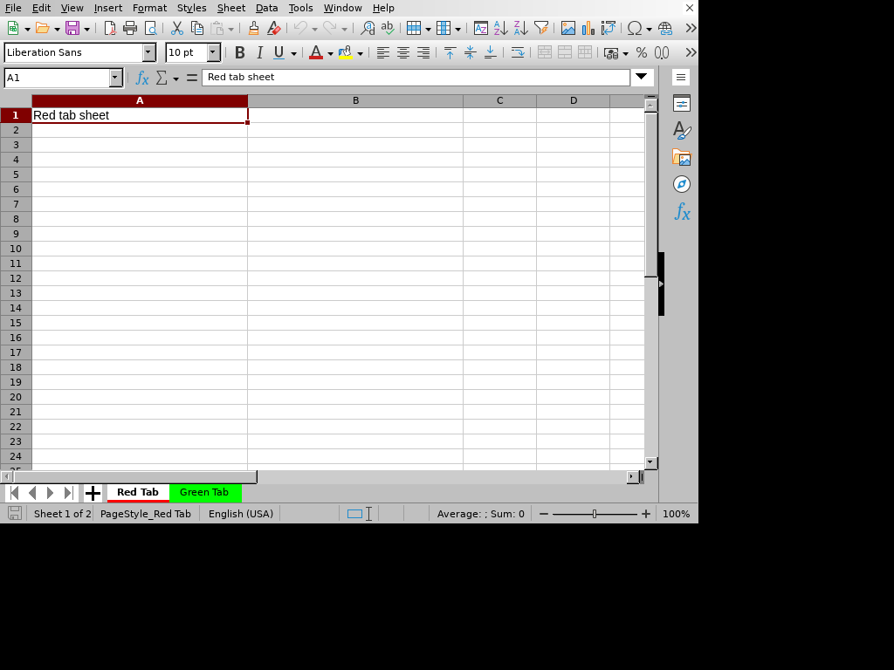</div>

### DSL Code

```ruby
# frozen_string_literal: true

require "xlsxrb"
output_path = ARGV[0] || "sheet_tab_colors.xlsx"
Xlsxrb.write(output_path) do |wb|
  wb.sheet("Red Tab") do |s|
    s.column(0, width: 25)
    s.column(1, width: 25)
    s.sheet_properties(:tab_color, :red)
    s.row(["Red tab sheet"])
  end
  wb.sheet("Green Tab") do |s|
    s.sheet_properties(:tab_color, :green)
    s.row(["Green tab sheet"])
  end
end
```

<hr/>

## Align Horizontal

[👉 Run and edit in Live Playground](../preview.html)

Demonstrates horizontal text alignment (left, center, right).

### Rendered Output (LibreOffice Calc)

<div></div>

### DSL Code

```ruby
# frozen_string_literal: true

require "xlsxrb"
output_path = ARGV[0] || "align_horizontal.xlsx"
Xlsxrb.write(output_path) do |wb|
  wb.style("left") { |s| s.align_horizontal("left") }
  wb.style("center") { |s| s.align_horizontal("center") }
  wb.style("right") { |s| s.align_horizontal("right") }
  wb.sheet("Alignment") do |s|
    s.print_options(:grid_lines, true)
    s.column(0, width: 20)
    s.column(1, width: 20)
    s.column(2, width: 20)
    s.row(%w[Left Center Right], styles: { 0 => "left", 1 => "center", 2 => "right" })
  end
end
```

<hr/>

## Align Horizontal Fill

[👉 Run and edit in Live Playground](../preview.html)

Demonstrates horizontal fill alignment (repeats value to fill cell width).

### Rendered Output (LibreOffice Calc)

<div></div>

### DSL Code

```ruby
# frozen_string_literal: true

require "xlsxrb"
output_path = ARGV[0] || "align_horizontal_fill.xlsx"
Xlsxrb.write(output_path) do |wb|
  wb.style("fill_align") { |s| s.align_horizontal("fill") }
  wb.sheet("Alignment") do |s|
    s.column(0, width: 30)
    s.row(["X "], styles: { 0 => "fill_align" })
  end
end
```

<hr/>

## Align Horizontal Justify

[👉 Run and edit in Live Playground](../preview.html)

Demonstrates horizontal justify text alignment.

### Rendered Output (LibreOffice Calc)

<div></div>

### DSL Code

```ruby
# frozen_string_literal: true

require "xlsxrb"
output_path = ARGV[0] || "align_horizontal_justify.xlsx"
Xlsxrb.write(output_path) do |wb|
  wb.style("justify_align") do |s|
    s.align_horizontal("justify")
    s.wrap_text(true)
  end
  wb.sheet("Alignment") do |s|
    s.column(0, width: 25)
    s.row(["Justified alignment wraps and distributes text evenly."], styles: { 0 => "justify_align" })
  end
end
```

<hr/>

## Align Vertical

[👉 Run and edit in Live Playground](../preview.html)

Demonstrates vertical text alignment (top, center, bottom).

### Rendered Output (LibreOffice Calc)

<div></div>

### DSL Code

```ruby
# frozen_string_literal: true

require "xlsxrb"
output_path = ARGV[0] || "align_vertical.xlsx"
Xlsxrb.write(output_path) do |wb|
  wb.style("top") { |s| s.align_vertical("top") }
  wb.style("center") { |s| s.align_vertical("center") }
  wb.style("bottom") { |s| s.align_vertical("bottom") }
  wb.sheet("Vertical Alignment") do |s|
    s.column(0, width: 25)
    s.column(1, width: 25)
    s.print_options(:grid_lines, true)
    s.row(%w[Top Center Bottom], styles: { 0 => "top", 1 => "center", 2 => "bottom" }, height: 40)
  end
end
```

<hr/>

## Align Text Wrap

[👉 Run and edit in Live Playground](../preview.html)

Demonstrates auto-wrapping multi-line text inside narrow cells.

### Rendered Output (LibreOffice Calc)

<div></div>

### DSL Code

```ruby
# frozen_string_literal: true

require "xlsxrb"
output_path = ARGV[0] || "align_text_wrap.xlsx"
Xlsxrb.write(output_path) do |wb|
  wb.style("wrap", &:wrap_text)
  wb.sheet("Text Wrap") do |s|
    s.print_options(:grid_lines, true)
    s.column(0, width: 15)
    s.row(["This is a long sentence that wraps inside the cell."], styles: { 0 => "wrap" })
  end
end
```

<hr/>

## Align Text Rotation

[👉 Run and edit in Live Playground](../preview.html)

Demonstrates text rotated by specific angles (45, 90 degrees).

### Rendered Output (LibreOffice Calc)

<div></div>

### DSL Code

```ruby
# frozen_string_literal: true

require "xlsxrb"
output_path = ARGV[0] || "align_text_rotation.xlsx"
Xlsxrb.write(output_path) do |wb|
  wb.style("rot_45") { |s| s.text_rotation(45) }
  wb.style("rot_90") { |s| s.text_rotation(90) }
  wb.sheet("Rotation") do |s|
    s.column(0, width: 25)
    s.column(1, width: 25)
    s.print_options(:grid_lines, true)
    s.row(["Rotated 45", "Rotated 90"], styles: { 0 => "rot_45", 1 => "rot_90" }, height: 50)
  end
end
```

<hr/>

## Align Indent

[👉 Run and edit in Live Playground](../preview.html)

Demonstrates text indentation inside cells.

### Rendered Output (LibreOffice Calc)

<div></div>

### DSL Code

```ruby
# frozen_string_literal: true

require "xlsxrb"
output_path = ARGV[0] || "align_indent.xlsx"
Xlsxrb.write(output_path) do |wb|
  wb.style("indent_1") { |s| s.align_horizontal("left").indent(1) }
  wb.style("indent_3") { |s| s.align_horizontal("left").indent(3) }
  wb.sheet("Indent") do |s|
    s.column(0, width: 25)
    s.column(1, width: 25)
    s.print_options(:grid_lines, true)
    s.row(["No Indent"])
    s.row(["Indent 1"], styles: { 0 => "indent_1" })
    s.row(["Indent 3"], styles: { 0 => "indent_3" })
  end
end
```

<hr/>

## Col Widths

[👉 Run and edit in Live Playground](../preview.html)

Demonstrates setting custom column widths.

### Rendered Output (LibreOffice Calc)

<div></div>

### DSL Code

```ruby
# frozen_string_literal: true

require "xlsxrb"
output_path = ARGV[0] || "col_widths.xlsx"
Xlsxrb.write(output_path) do |wb|
  wb.style("border") { |style| style.border_all(style: "thin", color: "FF000000") }
  wb.sheet("Widths") do |s|
    s.column(0, width: 30)
    s.column(1, width: 10)
    s.row(["Wide Column A", "Narrow B"], styles: %w[border border])
  end
end
```

<hr/>

## Col Width Tall

[👉 Run and edit in Live Playground](../preview.html)

Demonstrates setting very wide column widths.

### Rendered Output (LibreOffice Calc)

<div></div>

### DSL Code

```ruby
# frozen_string_literal: true

require "xlsxrb"
output_path = ARGV[0] || "col_width_tall.xlsx"
Xlsxrb.write(output_path) do |wb|
  wb.style("border") { |style| style.border_all(style: "thin", color: "FF000000") }
  wb.sheet("Col Width") do |s|
    s.column(0, width: 50)
    s.column(1, width: 10)
    s.row(["Very Wide Column (Width 50)", "Normal (10)"], styles: %w[border border])
  end
end
```

<hr/>

## Row Heights

[👉 Run and edit in Live Playground](../preview.html)

Demonstrates setting custom row heights.

### Rendered Output (LibreOffice Calc)

<div></div>

### DSL Code

```ruby
# frozen_string_literal: true

require "xlsxrb"
output_path = ARGV[0] || "row_heights.xlsx"
Xlsxrb.write(output_path) do |wb|
  wb.style("border") { |style| style.border_all(style: "thin", color: "FF000000") }
  wb.sheet("Heights") do |s|
    s.column(0, width: 25)
    s.column(1, width: 25)
    s.row(["Normal Row", ""], styles: %w[border border])
    s.row(["Tall Row", ""], height: 40, styles: %w[border border])
  end
end
```

<hr/>

## Row Height Tall

[👉 Run and edit in Live Playground](../preview.html)

Demonstrates setting very tall row heights.

### Rendered Output (LibreOffice Calc)

<div></div>

### DSL Code

```ruby
# frozen_string_literal: true

require "xlsxrb"
output_path = ARGV[0] || "row_height_tall.xlsx"
Xlsxrb.write(output_path) do |wb|
  wb.style("border") { |style| style.border_all(style: "thin", color: "FF000000") }
  wb.sheet("Row Height") do |s|
    s.column(0, width: 25)
    s.column(1, width: 25)
    s.row(["Very Tall Row (Height 60)", ""], height: 60, styles: %w[border border])
    s.row(["Normal Row", ""], styles: %w[border border])
  end
end
```

<hr/>

## Merge Freeze

[👉 Run and edit in Live Playground](../preview.html)

Demonstrates merging a cell range into a single cell, and freezing the top rows of a sheet.

### Rendered Output (LibreOffice Calc)

<div></div>

### DSL Code

```ruby
# frozen_string_literal: true

require "xlsxrb"

output_path = ARGV[0] || "merge_freeze.xlsx"

Xlsxrb.write(output_path) do |wb|
  wb.style("title") { |style| style.border_all(style: "thin", color: "FF000000").align_horizontal("center") }
  wb.style("border") { |style| style.border_all(style: "thin", color: "FF000000") }
  wb.sheet("Merge & Freeze") do |s|
    s.sheet_properties(:fit_to_page, true)
    s.page_setup(fit_to_width: 1, fit_to_height: 1)
    s.column(0, width: 25)
    s.column(1, width: 25)
    s.column(2, width: 25)
    s.row(["Merged Title Row", nil, nil], styles: %w[title title title])
    s.row(["Header A", "Header B", "Header C"], styles: %w[border border border])
    s.row(["Row 1 Col A", "Row 1 Col B", "Row 1 Col C"], styles: %w[border border border])
    s.row(["Row 2 Col A", "Row 2 Col B", "Row 2 Col C"], styles: %w[border border border])

    s.merge("A1:C1")
    s.freeze_pane(row: 2, col: 0)
  end
end
```

<hr/>

## Col Grouping

[👉 Run and edit in Live Playground](../preview.html)

Demonstrates outline grouping for columns.

### Rendered Output (LibreOffice Calc)

<div></div>

### DSL Code

```ruby
# frozen_string_literal: true

require "xlsxrb"
output_path = ARGV[0] || "col_grouping.xlsx"
Xlsxrb.write(output_path) do |wb|
  wb.style("border") { |style| style.border_all(style: "thin", color: "FF000000") }
  wb.sheet("Col Grouping") do |s|
    s.sheet_properties(:fit_to_page, true)
    s.page_setup(fit_to_width: 1, fit_to_height: 1)
    s.column(0, width: 25, outline_level: 0)
    s.column(1, width: 25, outline_level: 1)
    s.column(2, width: 25, outline_level: 1)
    s.row(["Col A", "Col B (Grouped)", "Col C (Grouped)"], styles: %w[border border border])
  end
end
```

<hr/>

## Row Grouping

[👉 Run and edit in Live Playground](../preview.html)

Demonstrates outline grouping for rows.

### Rendered Output (LibreOffice Calc)

<div></div>

### DSL Code

```ruby
# frozen_string_literal: true

require "xlsxrb"
output_path = ARGV[0] || "row_grouping.xlsx"
Xlsxrb.write(output_path) do |wb|
  wb.style("parent") { |style| style.border_all(style: "thin", color: "FF000000").bold }
  wb.style("child") { |style| style.border_all(style: "thin", color: "FF000000").align_horizontal("left").indent(2) }
  wb.sheet("Row Grouping") do |s|
    s.column(0, width: 25)
    s.column(1, width: 25)
    s.row(["Parent Row 1", ""], styles: %w[parent parent])
    s.row(["Child Row 1.1", ""], outline_level: 1, styles: %w[child child])
    s.row(["Child Row 1.2", ""], outline_level: 1, styles: %w[child child])
  end
end
```

<hr/>

## Cell Num Currency Jpy

[👉 Run and edit in Live Playground](../preview.html?example=number_formats)

Demonstrates Yen Currency format code formatting.

### Rendered Output (LibreOffice Calc)

<div></div>

### DSL Code

```ruby
# frozen_string_literal: true

require "xlsxrb"
output_path = ARGV[0] || "cell_num_currency_jpy.xlsx"
Xlsxrb.write(output_path) do |wb|
  wb.style("jpy") { |s| s.num_fmt("¥#,##0;[Red]¥-#,##0") }
  wb.sheet("JPY Currency") do |s|
    s.column(0, width: 25)
    s.column(1, width: 25)
    s.row(%w[Format Value])
    s.row(["Positive Yen", 12_500], styles: { 1 => "jpy" })
    s.row(["Negative Yen", -8000], styles: { 1 => "jpy" })
  end
end
```

<hr/>

## Cell Num Percent Decimals

[👉 Run and edit in Live Playground](../preview.html)

Demonstrates percentages with two decimal places (0.00%).

### Rendered Output (LibreOffice Calc)

<div></div>

### DSL Code

```ruby
# frozen_string_literal: true

require "xlsxrb"
output_path = ARGV[0] || "cell_num_percent_decimals.xlsx"
Xlsxrb.write(output_path) do |wb|
  wb.style("pct2") { |s| s.num_fmt("0.00%") }
  wb.sheet("Percents") do |s|
    s.column(0, width: 25)
    s.column(1, width: 25)
    s.row(%w[Format Value])
    s.row(["Percent with 2 Decimals", 0.12345], styles: { 1 => "pct2" })
  end
end
```

<hr/>

## Cell Num Scientific

[👉 Run and edit in Live Playground](../preview.html)

Demonstrates scientific number formats (0.00E+00).

### Rendered Output (LibreOffice Calc)

<div></div>

### DSL Code

```ruby
# frozen_string_literal: true

require "xlsxrb"
output_path = ARGV[0] || "cell_num_scientific.xlsx"
Xlsxrb.write(output_path) do |wb|
  wb.style("sci") { |s| s.num_fmt("0.00E+00") }
  wb.sheet("Scientific") do |s|
    s.column(0, width: 25)
    s.column(1, width: 25)
    s.row(%w[Format Value])
    s.row(["Scientific", 123_456_789.0], styles: { 1 => "sci" })
    s.row(["Small Scientific", 0.00001234], styles: { 1 => "sci" })
  end
end
```

<hr/>

## Cell Num Fractions

[👉 Run and edit in Live Playground](../preview.html)

Demonstrates fraction number formats (# ?/?).

### Rendered Output (LibreOffice Calc)

<div></div>

### DSL Code

```ruby
# frozen_string_literal: true

require "xlsxrb"
output_path = ARGV[0] || "cell_num_fractions.xlsx"
Xlsxrb.write(output_path) do |wb|
  wb.style("frac") { |s| s.num_fmt("# ?/?") }
  wb.sheet("Fractions") do |s|
    s.column(0, width: 25)
    s.column(1, width: 25)
    s.row(%w[Format Value])
    s.row(["Half", 0.5], styles: { 1 => "frac" })
    s.row(["Third", 0.3333], styles: { 1 => "frac" })
    s.row(["Quarter", 0.75], styles: { 1 => "frac" })
  end
end
```

<hr/>

## Cell Num Custom Colors

[👉 Run and edit in Live Playground](../preview.html)

Demonstrates custom colored formats for positive and negative numbers.

### Rendered Output (LibreOffice Calc)

<div></div>

### DSL Code

```ruby
# frozen_string_literal: true

require "xlsxrb"
output_path = ARGV[0] || "cell_num_custom_colors.xlsx"
Xlsxrb.write(output_path) do |wb|
  wb.style("custom_color") { |s| s.num_fmt("[Green]#,##0;[Red]-#,##0") }
  wb.sheet("Custom Colors") do |s|
    s.column(0, width: 25)
    s.column(1, width: 25)
    s.row(%w[Format Value])
    s.row(["Positive (Green)", 5000], styles: { 1 => "custom_color" })
    s.row(["Negative (Red)", -2500], styles: { 1 => "custom_color" })
  end
end
```

<hr/>

## Conditional Formatting

[👉 Run and edit in Live Playground](../preview.html?example=conditional_formatting)

Demonstrates adding conditional formatting rules that style cells automatically based on value ranges.

### Rendered Output (LibreOffice Calc)

<div></div>

### DSL Code

```ruby
# frozen_string_literal: true

require "xlsxrb"

output_path = ARGV[0] || "conditional_formatting.xlsx"

Xlsxrb.write(output_path) do |wb|
  wb.style("center") { |style| style.align_horizontal("center") }
  wb.sheet("Scores") do |s|
    s.column(0, width: 25)
    s.column(1, width: 25)
    s.row([90, 45, 72, 88], styles: %w[center center center center])

    s.conditional_format("A1:D1",
                         type: :cell_is, operator: :greaterThan,
                         formula: "80", priority: 1,
                         fill_color: "FFFFC7CE")
  end
end
```

<hr/>

## Cf Color Scale

[👉 Run and edit in Live Playground](../preview.html)

Demonstrates color scale/heatmap conditional formatting.

### Rendered Output (LibreOffice Calc)

<div></div>

### DSL Code

```ruby
# frozen_string_literal: true

require "xlsxrb"
output_path = ARGV[0] || "cf_color_scale.xlsx"
Xlsxrb.write(output_path) do |wb|
  wb.style("center") { |style| style.align_horizontal("center") }
  wb.sheet("Colors") do |s|
    s.column(0, width: 25)
    s.column(1, width: 25)
    s.row([10], styles: "center")
    s.row([50], styles: "center")
    s.row([90], styles: "center")
    s.conditional_format("A1:A3", type: :colorScale, priority: 1)
  end
end
```

<hr/>

## Cf Data Bar

[👉 Run and edit in Live Playground](../preview.html)

Demonstrates data bar visual conditional formatting indicators.

### Rendered Output (LibreOffice Calc)

<div></div>

### DSL Code

```ruby
# frozen_string_literal: true

require "xlsxrb"
output_path = ARGV[0] || "cf_data_bar.xlsx"
Xlsxrb.write(output_path) do |wb|
  wb.style("center") { |style| style.align_horizontal("center") }
  wb.sheet("Data Bars") do |s|
    s.column(0, width: 25)
    s.column(1, width: 25)
    s.row([20], styles: "center")
    s.row([60], styles: "center")
    s.row([100], styles: "center")
    s.conditional_format("A1:A3", type: :dataBar, priority: 1, color: "FF0070C0")
  end
end
```

<hr/>

## Cf Icon Set

[👉 Run and edit in Live Playground](../preview.html)

Demonstrates icon set indicators (red/yellow/green arrows).

### Rendered Output (LibreOffice Calc)

<div></div>

### DSL Code

```ruby
# frozen_string_literal: true

require "xlsxrb"
output_path = ARGV[0] || "cf_icon_set.xlsx"
Xlsxrb.write(output_path) do |wb|
  wb.style("center") { |style| style.align_horizontal("center") }
  wb.sheet("Icons") do |s|
    s.column(0, width: 25)
    s.column(1, width: 25)
    s.row([25], styles: "center")
    s.row([50], styles: "center")
    s.row([75], styles: "center")
    s.conditional_format("A1:A3", type: :iconSet, icon_style: "3Arrows", priority: 1)
  end
end
```

<hr/>

## Cf Cell Greater Than

[👉 Run and edit in Live Playground](../preview.html)

Demonstrates conditional formatting highlighting cells greater than a threshold.

### Rendered Output (LibreOffice Calc)

<div></div>

### DSL Code

```ruby
# frozen_string_literal: true

require "xlsxrb"
output_path = ARGV[0] || "cf_cell_greater_than.xlsx"
Xlsxrb.write(output_path) do |wb|
  wb.style("center") { |style| style.align_horizontal("center") }
  wb.sheet("CF Greater") do |s|
    s.column(0, width: 25)
    s.column(1, width: 25)
    s.row(["Values"])
    s.row([25], styles: "center")
    s.row([75], styles: "center")
    s.row([10], styles: "center")
    s.conditional_format("A2:A4", type: "cellIs", operator: "greaterThan", formula: "50", fill_color: "FFFFC7CE")
  end
end
```

<hr/>

## Cf Cell Less Than

[👉 Run and edit in Live Playground](../preview.html)

Demonstrates conditional formatting highlighting cells less than a threshold.

### Rendered Output (LibreOffice Calc)

<div></div>

### DSL Code

```ruby
# frozen_string_literal: true

require "xlsxrb"
output_path = ARGV[0] || "cf_cell_less_than.xlsx"
Xlsxrb.write(output_path) do |wb|
  wb.style("center") { |style| style.align_horizontal("center") }
  wb.sheet("CF Less") do |s|
    s.column(0, width: 25)
    s.column(1, width: 25)
    s.row(["Values"])
    s.row([25], styles: "center")
    s.row([75], styles: "center")
    s.row([10], styles: "center")
    s.conditional_format("A2:A4", type: "cellIs", operator: "lessThan", formula: "20", fill_color: "FFFFC7CE")
  end
end
```

<hr/>

## Cf Cell Equal To

[👉 Run and edit in Live Playground](../preview.html)

Demonstrates conditional formatting highlighting cells equal to a target value.

### Rendered Output (LibreOffice Calc)

<div></div>

### DSL Code

```ruby
# frozen_string_literal: true

require "xlsxrb"
output_path = ARGV[0] || "cf_cell_equal_to.xlsx"
Xlsxrb.write(output_path) do |wb|
  wb.style("center") { |style| style.align_horizontal("center") }
  wb.sheet("CF Equal") do |s|
    s.column(0, width: 25)
    s.column(1, width: 25)
    s.row(["Values"])
    s.row([10], styles: "center")
    s.row([20], styles: "center")
    s.row([10], styles: "center")
    s.conditional_format("A2:A4", type: "cellIs", operator: "equal", formula: "10", fill_color: "FFFFC7CE")
  end
end
```

<hr/>

## Cf Cell Between

[👉 Run and edit in Live Playground](../preview.html)

Demonstrates conditional formatting highlighting cells within a range.

### Rendered Output (LibreOffice Calc)

<div></div>

### DSL Code

```ruby
# frozen_string_literal: true

require "xlsxrb"
output_path = ARGV[0] || "cf_cell_between.xlsx"
Xlsxrb.write(output_path) do |wb|
  wb.style("center") { |style| style.align_horizontal("center") }
  wb.sheet("CF Between") do |s|
    s.column(0, width: 25)
    s.column(1, width: 25)
    s.row(["Values"])
    s.row([15], styles: "center")
    s.row([25], styles: "center")
    s.row([5], styles: "center")
    s.conditional_format("A2:A4", type: "cellIs", operator: "between", formulas: %w[10 20], fill_color: :green)
  end
end
```

<hr/>

## Cf Cell Greater Equal

[👉 Run and edit in Live Playground](../preview.html)

Demonstrates conditional formatting highlighting cells greater than or equal to a threshold.

### Rendered Output (LibreOffice Calc)

<div></div>

### DSL Code

```ruby
# frozen_string_literal: true

require "xlsxrb"
output_path = ARGV[0] || "cf_cell_greater_equal.xlsx"
Xlsxrb.write(output_path) do |wb|
  wb.style("center") { |style| style.align_horizontal("center") }
  wb.sheet("CF Greater Equal") do |s|
    s.column(0, width: 25)
    s.column(1, width: 25)
    s.row(["Values"])
    s.row([10], styles: "center")
    s.row([50], styles: "center")
    s.row([100], styles: "center")
    s.conditional_format("A2:A4", type: "cellIs", operator: "greaterThanOrEqual", formula: "50", fill_color: "FFFFC7CE")
  end
end
```

<hr/>

## Cf Contains Text

[👉 Run and edit in Live Playground](../preview.html)

Demonstrates conditional formatting highlighting cells containing specific text.

### Rendered Output (LibreOffice Calc)

<div></div>

### DSL Code

```ruby
# frozen_string_literal: true

require "xlsxrb"
output_path = ARGV[0] || "cf_contains_text.xlsx"
Xlsxrb.write(output_path) do |wb|
  wb.sheet("CF Contains") do |s|
    s.column(0, width: 25)
    s.column(1, width: 25)
    s.row(["Status"])
    s.row(["Error"])
    s.row(["Success"])
    s.row(["Pending"])
    s.conditional_format("A2:A4", type: "containsText", operator: "containsText", text: "Error", formula: 'NOT(ISERROR(SEARCH("Error",A2)))', fill_color: :red)
  end
end
```

<hr/>

## Cf Begins With

[👉 Run and edit in Live Playground](../preview.html)

Demonstrates conditional formatting highlighting cells starting with specific text.

### Rendered Output (LibreOffice Calc)

<div></div>

### DSL Code

```ruby
# frozen_string_literal: true

require "xlsxrb"
output_path = ARGV[0] || "cf_begins_with.xlsx"
Xlsxrb.write(output_path) do |wb|
  wb.sheet("CF Begins") do |s|
    s.column(0, width: 25)
    s.column(1, width: 25)
    s.row(["Code"])
    s.row(["A-100"])
    s.row(["B-200"])
    s.row(["A-300"])
    s.conditional_format("A2:A4", type: "beginsWith", operator: "beginsWith", text: "A", formula: 'LEFT(A2,1)="A"', fill_color: "FFFFC7CE")
  end
end
```

<hr/>

## Cf Ends With

[👉 Run and edit in Live Playground](../preview.html)

Demonstrates conditional formatting highlighting cells ending with specific text.

### Rendered Output (LibreOffice Calc)

<div></div>

### DSL Code

```ruby
# frozen_string_literal: true

require "xlsxrb"
output_path = ARGV[0] || "cf_ends_with.xlsx"
Xlsxrb.write(output_path) do |wb|
  wb.sheet("CF Ends") do |s|
    s.column(0, width: 25)
    s.column(1, width: 25)
    s.row(["Code"])
    s.row(["100-Z"])
    s.row(["200-Y"])
    s.row(["300-Z"])
    s.conditional_format("A2:A4", type: "endsWith", operator: "endsWith", text: "Z", formula: 'RIGHT(A2,1)="Z"', fill_color: "FFFFC7CE")
  end
end
```

<hr/>

## Cf Expression Formula

[👉 Run and edit in Live Playground](../preview.html)

Demonstrates conditional formatting using a custom formula expression.

### Rendered Output (LibreOffice Calc)

<div></div>

### DSL Code

```ruby
# frozen_string_literal: true

require "xlsxrb"
output_path = ARGV[0] || "cf_expression_formula.xlsx"
Xlsxrb.write(output_path) do |wb|
  wb.style("center") { |style| style.align_horizontal("center") }
  wb.sheet("CF Expression") do |s|
    s.column(0, width: 25)
    s.column(1, width: 25)
    s.row(["Values"])
    s.row([10], styles: "center")
    s.row([20], styles: "center")
    s.row([30], styles: "center")
    s.row([100], styles: "center") # Average is 40. 100 is above average.
    s.conditional_format("A2:A5", type: "expression", formula: "A2>AVERAGE($A$2:$A$5)", fill_color: "FFFFC7CE")
  end
end
```

<hr/>

## Chart Bar

[👉 Run and edit in Live Playground](../preview.html?example=chart_bar)

Demonstrates embedding a standard 2D Bar Chart referencing worksheet cell ranges.

### Rendered Output (LibreOffice Calc)

<div></div>

### DSL Code

```ruby
# frozen_string_literal: true

require "xlsxrb"

output_path = ARGV[0] || "chart_bar.xlsx"

Xlsxrb.write(output_path) do |wb|
  wb.sheet("Sales Data") do |s|
    s.sheet_properties(:fit_to_page, true)
    s.page_setup(fit_to_width: 1, fit_to_height: 1)
    s.column(0, width: 25)
    s.column(1, width: 25)
    s.row(%w[Month Value])
    s.row(["Jan", 100])
    s.row(["Feb", 200])

    s.chart(
      type: :bar,
      title: "Monthly Sales",
      from_col: 3,
      from_row: 0,
      to_col: 8,
      to_row: 12,
      series: [
        { cat_ref: "'Sales Data'!$A$2:$A$3", val_ref: "'Sales Data'!$B$2:$B$3", fill_color: "4F81BD" }
      ]
    )
  end
end
```

<hr/>

## Chart Bar Stacked

[👉 Run and edit in Live Playground](../preview.html)

Demonstrates embedding a stacked 2D Bar Chart.

### Rendered Output (LibreOffice Calc)

<div></div>

### DSL Code

```ruby
# frozen_string_literal: true

require "xlsxrb"
output_path = ARGV[0] || "chart_bar_stacked.xlsx"
Xlsxrb.write(output_path) do |wb|
  wb.sheet("Data") do |s|
    s.column(0, width: 25)
    s.column(1, width: 25)
    s.row(["Year", "Sales A", "Sales B"])
    s.row([2024, 100, 150])
    s.row([2025, 120, 180])
    s.row([2026, 140, 210])
    s.sheet_properties(:fit_to_page, true)
    s.page_setup(fit_to_width: 1, fit_to_height: 1)
    s.chart(
      type: :bar,
      grouping: :stacked,
      title: "Stacked Bar Chart",
      from_col: 0, from_row: 5, to_col: 6, to_row: 17,
      series: [
        { cat_ref: "'Data'!$A$2:$A$4", val_ref: "'Data'!$B$2:$B$4", name: "'Data'!$B$1", fill_color: "4F81BD" },
        { cat_ref: "'Data'!$A$2:$A$4", val_ref: "'Data'!$C$2:$C$4", name: "'Data'!$C$1", fill_color: "C0504D" }
      ]
    )
  end
end
```

<hr/>

## Chart Bar Percent Stacked

[👉 Run and edit in Live Playground](../preview.html)

Demonstrates embedding a 100% stacked 2D Bar Chart.

### Rendered Output (LibreOffice Calc)

<div></div>

### DSL Code

```ruby
# frozen_string_literal: true

require "xlsxrb"
output_path = ARGV[0] || "chart_bar_percent_stacked.xlsx"
Xlsxrb.write(output_path) do |wb|
  wb.sheet("Data") do |s|
    s.column(0, width: 25)
    s.column(1, width: 25)
    s.row(["Year", "Sales A", "Sales B"])
    s.row([2024, 100, 150])
    s.row([2025, 120, 180])
    s.row([2026, 140, 210])
    s.sheet_properties(:fit_to_page, true)
    s.page_setup(fit_to_width: 1, fit_to_height: 1)
    s.chart(
      type: :bar,
      grouping: :percentStacked,
      title: "100% Stacked Bar Chart",
      from_col: 0, from_row: 5, to_col: 6, to_row: 17,
      series: [
        { cat_ref: "'Data'!$A$2:$A$4", val_ref: "'Data'!$B$2:$B$4", name: "'Data'!$B$1", fill_color: "4F81BD" },
        { cat_ref: "'Data'!$A$2:$A$4", val_ref: "'Data'!$C$2:$C$4", name: "'Data'!$C$1", fill_color: "C0504D" }
      ]
    )
  end
end
```

<hr/>

## Chart Line

[👉 Run and edit in Live Playground](../preview.html?example=chart_line)

Demonstrates embedding a standard 2D Line Chart.

### Rendered Output (LibreOffice Calc)

<div></div>

### DSL Code

```ruby
# frozen_string_literal: true

require "xlsxrb"
output_path = ARGV[0] || "chart_line.xlsx"
Xlsxrb.write(output_path) do |wb|
  wb.sheet("Data") do |s|
    s.sheet_properties(:fit_to_page, true)
    s.page_setup(fit_to_width: 1, fit_to_height: 1)
    s.column(0, width: 25)
    s.column(1, width: 25)
    s.row(%w[Day Value])
    s.row(["Mon", 10])
    s.row(["Tue", 15])
    s.row(["Wed", 12])
    s.chart(
      type: :line,
      title: "Daily Value",
      from_col: 3, from_row: 0, to_col: 8, to_row: 12,
      series: [{ cat_ref: "Data!$A$2:$A$4", val_ref: "Data!$B$2:$B$4", line_color: "4F81BD", line_width: 2.0 }]
    )
  end
end
```

<hr/>

## Chart Line Stacked

[👉 Run and edit in Live Playground](../preview.html)

Demonstrates embedding a stacked 2D Line Chart.

### Rendered Output (LibreOffice Calc)

<div></div>

### DSL Code

```ruby
# frozen_string_literal: true

require "xlsxrb"
output_path = ARGV[0] || "chart_line_stacked.xlsx"
Xlsxrb.write(output_path) do |wb|
  wb.sheet("Data") do |s|
    s.column(0, width: 25)
    s.column(1, width: 25)
    s.row(["Year", "Sales A", "Sales B"])
    s.row([2024, 100, 150])
    s.row([2025, 120, 180])
    s.row([2026, 140, 210])
    s.sheet_properties(:fit_to_page, true)
    s.page_setup(fit_to_width: 1, fit_to_height: 1)
    s.chart(
      type: :line,
      grouping: :stacked,
      title: "Stacked Line Chart",
      from_col: 0, from_row: 5, to_col: 6, to_row: 17,
      series: [
        { cat_ref: "'Data'!$A$2:$A$4", val_ref: "'Data'!$B$2:$B$4", name: "'Data'!$B$1", line_color: "4F81BD", line_width: 2.0 },
        { cat_ref: "'Data'!$A$2:$A$4", val_ref: "'Data'!$C$2:$C$4", name: "'Data'!$C$1", line_color: "C0504D", line_width: 2.0 }
      ]
    )
  end
end
```

<hr/>

## Chart Area

[👉 Run and edit in Live Playground](../preview.html)

Demonstrates embedding a standard 2D Area Chart.

### Rendered Output (LibreOffice Calc)

<div></div>

### DSL Code

```ruby
# frozen_string_literal: true

require "xlsxrb"
output_path = ARGV[0] || "chart_area.xlsx"
Xlsxrb.write(output_path) do |wb|
  wb.sheet("Data") do |s|
    s.sheet_properties(:fit_to_page, true)
    s.page_setup(fit_to_width: 1, fit_to_height: 1)
    s.column(0, width: 25)
    s.column(1, width: 25)
    s.row(%w[Day Value])
    s.row(["Mon", 10])
    s.row(["Tue", 15])
    s.chart(
      type: :area,
      title: "Daily Area",
      from_col: 3, from_row: 0, to_col: 8, to_row: 12,
      series: [{ cat_ref: "Data!$A$2:$A$3", val_ref: "Data!$B$2:$B$3", fill_color: "4F81BD" }]
    )
  end
end
```

<hr/>

## Chart Area Stacked

[👉 Run and edit in Live Playground](../preview.html)

Demonstrates embedding a stacked 2D Area Chart.

### Rendered Output (LibreOffice Calc)

<div></div>

### DSL Code

```ruby
# frozen_string_literal: true

require "xlsxrb"
output_path = ARGV[0] || "chart_area_stacked.xlsx"
Xlsxrb.write(output_path) do |wb|
  wb.sheet("Data") do |s|
    s.column(0, width: 25)
    s.column(1, width: 25)
    s.row(["Year", "Sales A", "Sales B"])
    s.row([2024, 100, 150])
    s.row([2025, 120, 180])
    s.row([2026, 140, 210])
    s.sheet_properties(:fit_to_page, true)
    s.page_setup(fit_to_width: 1, fit_to_height: 1)
    s.chart(
      type: :area,
      grouping: :stacked,
      title: "Stacked Area Chart",
      from_col: 0, from_row: 5, to_col: 6, to_row: 17,
      series: [
        { cat_ref: "'Data'!$A$2:$A$4", val_ref: "'Data'!$B$2:$B$4", name: "'Data'!$B$1", fill_color: "4F81BD" },
        { cat_ref: "'Data'!$A$2:$A$4", val_ref: "'Data'!$C$2:$C$4", name: "'Data'!$C$1", fill_color: "C0504D" }
      ]
    )
  end
end
```

<hr/>

## Chart Pie

[👉 Run and edit in Live Playground](../preview.html?example=chart_pie)

Demonstrates embedding a standard 2D Pie Chart.

### Rendered Output (LibreOffice Calc)

<div></div>

### DSL Code

```ruby
# frozen_string_literal: true

require "xlsxrb"
output_path = ARGV[0] || "chart_pie.xlsx"
Xlsxrb.write(output_path) do |wb|
  wb.sheet("Data") do |s|
    s.sheet_properties(:fit_to_page, true)
    s.page_setup(fit_to_width: 1, fit_to_height: 1)
    s.column(0, width: 25)
    s.column(1, width: 25)
    s.row(%w[Label Percent])
    s.row(["Yes", 70])
    s.row(["No", 30])
    s.chart(
      type: :pie,
      title: "Responses",
      from_col: 3, from_row: 0, to_col: 8, to_row: 12,
      series: [{
        cat_ref: "Data!$A$2:$A$3",
        val_ref: "Data!$B$2:$B$3",
        data_points: [
          { idx: 0, fill_color: "4F81BD" },
          { idx: 1, fill_color: "C0504D" }
        ]
      }]
    )
  end
end
```

<hr/>

## Chart Doughnut

[👉 Run and edit in Live Playground](../preview.html)

Demonstrates embedding a standard 2D Doughnut Chart.

### Rendered Output (LibreOffice Calc)

<div></div>

### DSL Code

```ruby
# frozen_string_literal: true

require "xlsxrb"
output_path = ARGV[0] || "chart_doughnut.xlsx"
Xlsxrb.write(output_path) do |wb|
  wb.sheet("Data") do |s|
    s.sheet_properties(:fit_to_page, true)
    s.page_setup(fit_to_width: 1, fit_to_height: 1)
    s.column(0, width: 25)
    s.column(1, width: 25)
    s.row(%w[Label Percent])
    s.row(["A", 40])
    s.row(["B", 60])
    s.chart(
      type: :doughnut,
      title: "Ratio",
      from_col: 3, from_row: 0, to_col: 8, to_row: 12,
      series: [{
        cat_ref: "Data!$A$2:$A$3",
        val_ref: "Data!$B$2:$B$3",
        data_points: [
          { idx: 0, fill_color: "4F81BD" },
          { idx: 1, fill_color: "C0504D" }
        ]
      }]
    )
  end
end
```

<hr/>

## Chart Scatter

[👉 Run and edit in Live Playground](../preview.html)

Demonstrates embedding a standard 2D Scatter Plot.

### Rendered Output (LibreOffice Calc)

<div></div>

### DSL Code

```ruby
# frozen_string_literal: true

require "xlsxrb"
output_path = ARGV[0] || "chart_scatter.xlsx"
Xlsxrb.write(output_path) do |wb|
  wb.sheet("Data") do |s|
    s.sheet_properties(:fit_to_page, true)
    s.page_setup(fit_to_width: 1, fit_to_height: 1)
    s.column(0, width: 25)
    s.column(1, width: 25)
    s.row(%w[X Y])
    s.row([1, 10])
    s.row([2, 15])
    s.chart(
      type: :scatter,
      title: "Scatter Plot",
      from_col: 3, from_row: 0, to_col: 8, to_row: 12,
      series: [{ cat_ref: "Data!$A$2:$A$3", val_ref: "Data!$B$2:$B$3", line_color: "4F81BD", line_width: 2.0 }]
    )
  end
end
```

<hr/>

## Chart Radar

[👉 Run and edit in Live Playground](../preview.html)

Demonstrates embedding a standard 2D Radar Chart.

### Rendered Output (LibreOffice Calc)

<div></div>

### DSL Code

```ruby
# frozen_string_literal: true

require "xlsxrb"
output_path = ARGV[0] || "chart_radar.xlsx"
Xlsxrb.write(output_path) do |wb|
  wb.sheet("Data") do |s|
    s.sheet_properties(:fit_to_page, true)
    s.page_setup(fit_to_width: 1, fit_to_height: 1)
    s.column(0, width: 25)
    s.column(1, width: 25)
    s.row(%w[Stat Value])
    s.row(["Atk", 80])
    s.row(["Def", 60])
    s.chart(
      type: :radar,
      title: "Stats",
      from_col: 3, from_row: 0, to_col: 8, to_row: 12,
      series: [{ cat_ref: "Data!$A$2:$A$3", val_ref: "Data!$B$2:$B$3", line_color: "4F81BD", line_width: 2.0 }]
    )
  end
end
```

<hr/>

## Sparkline Line

[👉 Run and edit in Live Playground](../preview.html)

Demonstrates embedded line sparklines in cell ranges.

### Rendered Output (LibreOffice Calc)

<div></div>

<div>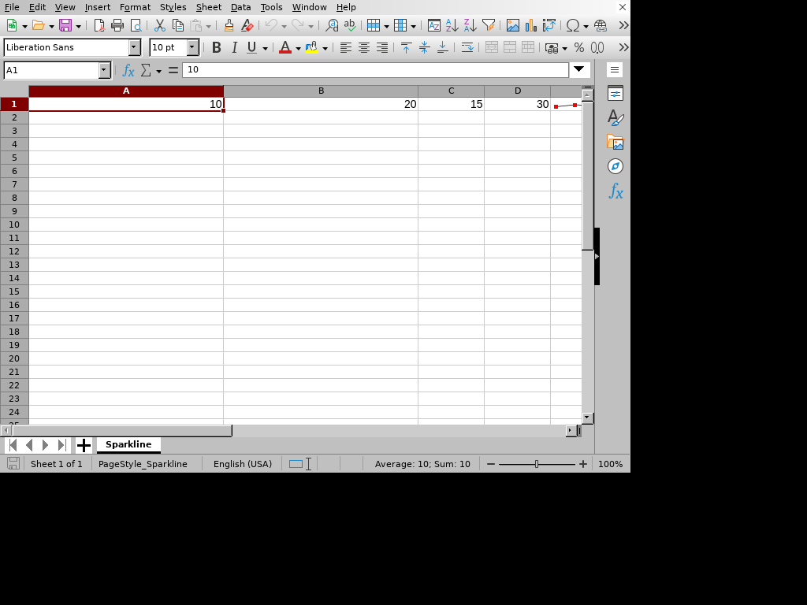</div>

### DSL Code

```ruby
# frozen_string_literal: true

require "xlsxrb"
output_path = ARGV[0] || "sparkline_line.xlsx"
Xlsxrb.write(output_path) do |wb|
  wb.sheet("Sparkline") do |s|
    s.sheet_properties(:fit_to_page, true)
    s.page_setup(fit_to_width: 1, fit_to_height: 1)
    s.column(0, width: 25)
    s.column(1, width: 25)
    s.row([10, 20, 15, 30, nil])
    s.sparkline_group(
      type: :line,
      markers: true,
      color_series: "FF000000",
      color_markers: :red,
      sparklines: [{ location_ref: "E1", data_ref: "Sparkline!A1:D1" }]
    )
  end
end
```

<hr/>

## Sparkline Column

[👉 Run and edit in Live Playground](../preview.html)

Demonstrates embedded column sparklines in cell ranges.

### Rendered Output (LibreOffice Calc)

<div></div>

### DSL Code

```ruby
# frozen_string_literal: true

require "xlsxrb"
output_path = ARGV[0] || "sparkline_column.xlsx"
Xlsxrb.write(output_path) do |wb|
  wb.sheet("Sparkline") do |s|
    s.sheet_properties(:fit_to_page, true)
    s.page_setup(fit_to_width: 1, fit_to_height: 1)
    s.column(0, width: 25)
    s.column(1, width: 25)
    s.row([5, 12, 8, 15, nil])
    s.sparkline_group(
      type: :column,
      sparklines: [{ location_ref: "E1", data_ref: "Sparkline!A1:D1" }]
    )
  end
end
```

<hr/>

## Table Styles

[👉 Run and edit in Live Playground](../preview.html?example=table_styles)

Demonstrates creating native Excel formatted tables (ListObjects) with named table styles, headers, and column definitions.

### Rendered Output (LibreOffice Calc)

<div></div>

### DSL Code

```ruby
# frozen_string_literal: true

require "xlsxrb"

output_path = ARGV[0] || "table_styles.xlsx"

Xlsxrb.write(output_path) do |wb|
  wb.sheet("Table Example") do |sheet|
    sheet.column(0, width: 8)
    sheet.column(1, width: 16)
    sheet.column(2, width: 16)
    sheet.column(3, width: 14)
    sheet.row(%w[ID Name Department Salary])
    sheet.row([101, "Alice Smith", "Engineering", 120_000])
    sheet.row([102, "Bob Jones", "Marketing", 95_000])
    sheet.row([103, "Carol White", "Sales", 110_000])
    sheet.row([104, "David Brown", "Engineering", 130_000])

    sheet.table("A1:D5", columns: %w[ID Name Department Salary], name: "EmployeeTable", style: "TableStyleMedium9", total_row: false)
  end
end
```

<hr/>

## Pivot Table

[👉 Run and edit in Live Playground](../preview.html)

Demonstrates embedding native Excel Pivot Tables summarizing regional data across quarters with sum aggregation.

### Rendered Output (LibreOffice Calc)

<div></div>

### DSL Code

```ruby
# frozen_string_literal: true

require "xlsxrb"

output_path = ARGV[0] || "pivot_table.xlsx"

Xlsxrb.write(output_path) do |wb|
  wb.sheet("SalesData") do |sheet|
    sheet.column(0..3, width: 14)
    sheet.row(%w[Region Quarter Sales Rep])
    sheet.row(["East", "Q1", 1000, "Alice"])
    sheet.row(["West", "Q1", 1500, "Bob"])
    sheet.row(["East", "Q2", 1200, "Alice"])
    sheet.row(["West", "Q2", 1800, "Bob"])
    sheet.row(["North", "Q1", 800, "Charlie"])
    sheet.row(["North", "Q2", 950, "Charlie"])

    sheet.row([])
    sheet.row([])
    # Pre-populate summary cells in the pivot table target region (A10:D15) for headless renderers
    sheet.row(["Sum of Sales", "Quarter", nil, nil])
    sheet.row(["Region", "Q1", "Q2", "Grand Total"])
    sheet.row(["East", 1000, 1200, 2200])
    sheet.row(["North", 800, 950, 1750])
    sheet.row(["West", 1500, 1800, 3300])
    sheet.row(["Grand Total", 3300, 3950, 7250])

    sheet.pivot_table(
      "SalesData!A1:D7",
      row_fields: ["Region"],
      data_fields: [{ name: "Sales", subtotal: "sum" }],
      col_fields: ["Quarter"],
      dest_ref: "A10",
      name: "RegionalSalesSummary"
    )
  end
end
```

<hr/>

## Drawing Shapes

[👉 Run and edit in Live Playground](../preview.html)

Demonstrates embedding vector shapes (rectangles, rounded rectangles, block arrows) with labels in worksheet drawings.

### Rendered Output (LibreOffice Calc)

<div></div>

### DSL Code

```ruby
# frozen_string_literal: true

require "xlsxrb"

output_path = ARGV[0] || "drawing_shapes.xlsx"

Xlsxrb.write(output_path) do |wb|
  wb.sheet("Shapes") do |sheet|
    sheet.column(0..4, width: 12)
    sheet.row(["Diagram with shapes and annotations"])
    sheet.row([])
    sheet.shape(preset: "rect", text: "Start", from_col: 0, from_row: 2, to_col: 1, to_row: 4)
    sheet.shape(preset: "rightArrow", text: "Next", from_col: 1, from_row: 3, to_col: 2, to_row: 4)
    sheet.shape(preset: "roundRect", text: "Processing", from_col: 2, from_row: 2, to_col: 4, to_row: 4)
  end
end
```

<hr/>

## Embedded Images

[👉 Run and edit in Live Playground](../preview.html)

Demonstrates embedding raster PNG images in cell ranges.

### Rendered Output (LibreOffice Calc)

<div></div>

### DSL Code

```ruby
# frozen_string_literal: true

require "xlsxrb"
output_path = ARGV[0] || "embedded_images.xlsx"

require "zlib"

def make_png(width, height, red, green, blue)
  png = "\x89PNG\r\n\x1a\n".dup.force_encoding("BINARY")
  ihdr_data = [width, height, 8, 2, 0, 0, 0].pack("N2C5")
  ihdr_chunk = "IHDR".dup.force_encoding("BINARY") + ihdr_data
  ihdr_crc = Zlib.crc32(ihdr_chunk)
  png << [ihdr_data.bytesize].pack("N") << ihdr_chunk << [ihdr_crc].pack("N")
  raw_data = Array.new(height) { "\x00".dup.force_encoding("BINARY") + ([red, green, blue].pack("C3") * width) }.join
  compressed = Zlib.deflate(raw_data)
  idat_chunk = "IDAT".dup.force_encoding("BINARY") + compressed
  idat_crc = Zlib.crc32(idat_chunk)
  png << [compressed.bytesize].pack("N") << idat_chunk << [idat_crc].pack("N")
  iend_chunk = "IEND".dup.force_encoding("BINARY")
  iend_crc = Zlib.crc32(iend_chunk)
  png << [0].pack("N") << iend_chunk << [iend_crc].pack("N")
  png
end

dummy_png = make_png(100, 100, 255, 0, 0)

Xlsxrb.write(output_path) do |wb|
  wb.style("center") { |st| st.align_horizontal(:center) }
  wb.sheet("Images") do |s|
    s.row(["Logo Target cell:", "", "", "Boundary"], styles: [nil, "center", "center", "center"])
    s.row(["", "", "", ""])
    s.row(["", "", "", ""])
    s.row(["", "", "", ""])
    s.row(["", "", "", "Boundary End"], styles: [nil, "center", "center", "center"])
    s.image(dummy_png, ext: "png", from_col: 1, from_row: 1, to_col: 3, to_row: 5)
    s.column(0, width: 20)
    s.column(1, width: 15)
    s.column(2, width: 15)
    s.column(3, width: 15)
  end
end
```

<hr/>

## Page Orientation Landscape

[👉 Run and edit in Live Playground](../preview.html)

Demonstrates landscape page setup for printing.

### Rendered Output (LibreOffice Calc)

<div></div>

### DSL Code

```ruby
# frozen_string_literal: true

require "xlsxrb"
output_path = ARGV[0] || "page_orientation_landscape.xlsx"
Xlsxrb.write(output_path) do |wb|
  wb.sheet("Landscape") do |s|
    s.column(0, width: 25)
    s.column(1, width: 25)
    s.page_setup(orientation: :landscape)
    s.row(["Landscape Orientation sheet"])
  end
end
```

<hr/>

## Page Paper Size A3

[👉 Run and edit in Live Playground](../preview.html)

Demonstrates setting paper size to A3 (paper size 8).

### Rendered Output (LibreOffice Calc)

<div></div>

### DSL Code

```ruby
# frozen_string_literal: true

require "xlsxrb"
output_path = ARGV[0] || "page_paper_size_a3.xlsx"
Xlsxrb.write(output_path) do |wb|
  wb.sheet("A3 Sheet") do |s|
    s.column(0, width: 25)
    s.column(1, width: 25)
    s.page_setup(paper_size: 8) # ISO A3 is paperSize="8"
    s.row(["ISO A3 Paper Size sheet"])
  end
end
```

<hr/>

## Page Margins Narrow

[👉 Run and edit in Live Playground](../preview.html)

Demonstrates setting narrow page margins.

### Rendered Output (LibreOffice Calc)

<div></div>

### DSL Code

```ruby
# frozen_string_literal: true

require "xlsxrb"
output_path = ARGV[0] || "page_margins_narrow.xlsx"
Xlsxrb.write(output_path) do |wb|
  wb.sheet("Narrow Margins") do |s|
    s.column(0, width: 25)
    s.column(1, width: 25)
    s.page_margins(top: 0.25, bottom: 0.25, left: 0.25, right: 0.25, header: 0.1, footer: 0.1)
    s.row(["Narrow Margins sheet"])
  end
end
```

<hr/>

## Page Margins Wide

[👉 Run and edit in Live Playground](../preview.html)

Demonstrates setting wide page margins.

### Rendered Output (LibreOffice Calc)

<div></div>

### DSL Code

```ruby
# frozen_string_literal: true

require "xlsxrb"
output_path = ARGV[0] || "page_margins_wide.xlsx"
Xlsxrb.write(output_path) do |wb|
  wb.sheet("Wide Margins") do |s|
    s.column(0, width: 25)
    s.column(1, width: 25)
    s.page_margins(top: 1.0, bottom: 1.0, left: 1.0, right: 1.0, header: 0.5, footer: 0.5)
    s.row(["Wide Margins sheet"])
  end
end
```

<hr/>

## Page Header Footer

[👉 Run and edit in Live Playground](../preview.html)

Demonstrates setting odd page headers and footers.

### Rendered Output (LibreOffice Calc)

<div></div>

### DSL Code

```ruby
# frozen_string_literal: true

require "xlsxrb"
output_path = ARGV[0] || "page_header_footer.xlsx"
Xlsxrb.write(output_path) do |wb|
  wb.sheet("Header Footer") do |s|
    s.column(0, width: 25)
    s.column(1, width: 25)
    s.header_footer(odd_header: "&LMy Company&RPage &P", odd_footer: "&CConfidential")
    s.row(["Header Footer sheet"])
  end
end
```

<hr/>

## Page Grid Lines Print

[👉 Run and edit in Live Playground](../preview.html)

Demonstrates enabling printing of grid lines.

### Rendered Output (LibreOffice Calc)

<div></div>

### DSL Code

```ruby
# frozen_string_literal: true

require "xlsxrb"
output_path = ARGV[0] || "page_grid_lines_print.xlsx"
Xlsxrb.write(output_path) do |wb|
  wb.sheet("Print Grid Lines") do |s|
    s.column(0, width: 25)
    s.column(1, width: 25)
    s.print_options(:grid_lines, true)
    s.row(["Grid Lines Printed sheet"])
  end
end
```

<hr/>

## Page Headings Print

[👉 Run and edit in Live Playground](../preview.html)

Demonstrates enabling printing of row and column headings.

### Rendered Output (LibreOffice Calc)

<div></div>

### DSL Code

```ruby
# frozen_string_literal: true

require "xlsxrb"
output_path = ARGV[0] || "page_headings_print.xlsx"
Xlsxrb.write(output_path) do |wb|
  wb.sheet("Print Headings") do |s|
    s.column(0, width: 25)
    s.column(1, width: 25)
    s.print_options(:headings, true)
    s.row(["Row/Col Headings Printed sheet"])
  end
end
```

<hr/>

## Page Repeat Rows

[👉 Run and edit in Live Playground](../preview.html)

Demonstrates repeating table header rows at the top of every printed page for multipage print layouts.

### Rendered Output (LibreOffice Calc)

<div></div>

### DSL Code

```ruby
# frozen_string_literal: true

require "xlsxrb"

output_path = ARGV[0] || "page_repeat_rows.xlsx"

Xlsxrb.write(output_path) do |wb|
  wb.style(:header, bold: true, fill_color: "4F81BD", font_color: "FFFFFF", align_horizontal: :center)
  wb.style(:border, border_all: { style: :thin, color: "D9D9D9" })

  wb.sheet("Repeat Rows") do |s|
    s.column(0, width: 12)
    s.column(1, width: 30)
    s.column(2, width: 20)

    s.row(%w[ID Description Status], styles: :header)
    40.times do |i|
      s.row([i + 1, "Report item #{i + 1}", i.even? ? "Completed" : "Pending"], styles: :border)
    end

    # Repeat top header row on every printed page
    s.repeat_rows("1:1")
    s.page_setup(orientation: :portrait, paper_size: 9)
  end
end
```

<hr/>

## Hyperlinks

[👉 Run and edit in Live Playground](../preview.html?example=hyperlinks)

Demonstrates cell hyperlinks to external web URLs with custom tooltips, and internal workbook links jumping to specific sheets.

### Rendered Output (LibreOffice Calc)

<div></div>

<div></div>

### DSL Code

```ruby
# frozen_string_literal: true

require "xlsxrb"

output_path = ARGV[0] || "hyperlinks.xlsx"

Xlsxrb.write(output_path) do |wb|
  wb.style(:header, bold: true, fill_color: "4F81BD", font_color: "FFFFFF", align_horizontal: :center)
  wb.style(:link, font_color: "0000FF", underline: true)
  wb.style(:border, border_all: { style: :thin, color: "D9D9D9" })

  wb.sheet("Links") do |s|
    s.column(0, width: 22)
    s.column(1, width: 35)

    s.row(%w[Link_Type Target_Description], styles: :header)
    s.row(["External Web URL", "Visit Ruby-Lang"], styles: %i[border link])
    s.row(["Internal Sheet", "Jump to Details Sheet"], styles: %i[border link])

    s.hyperlink("B2", "https://www.ruby-lang.org", display: "Visit Ruby-Lang", tooltip: "Official Ruby Website")
    s.hyperlink("B3", location: "Details!A1", tooltip: "Go to Details sheet")
  end

  wb.sheet("Details") do |s|
    s.column(0, width: 30)
    s.row(["Target destination sheet (A1)"])
  end
end
```

<hr/>

## Sheet Protection

[👉 Run and edit in Live Playground](../preview.html)

Demonstrates locking and password-protecting worksheets against modifications while configuring user interaction permissions.

### Rendered Output (LibreOffice Calc)

<div></div>

### DSL Code

```ruby
# frozen_string_literal: true

require "xlsxrb"

output_path = ARGV[0] || "sheet_protection.xlsx"

Xlsxrb.write(output_path) do |wb|
  wb.style(:header, bold: true, fill_color: "4F81BD", font_color: "FFFFFF")
  wb.style(:cell, border_all: { style: :thin, color: "D9D9D9" })

  wb.sheet("Protected Sheet") do |s|
    s.column(0, width: 20)
    s.column(1, width: 30)

    s.row(%w[Setting Status], styles: :header)
    s.row(["Protection", "Enabled with password"], styles: :cell)
    s.row(["Select Locked", "Allowed"], styles: :cell)
    s.row(["Select Unlocked", "Allowed"], styles: :cell)

    # Protect worksheet against unauthorized edits
    s.protect_sheet(password: "secret", select_locked_cells: true, select_unlocked_cells: true)
  end
end
```

<hr/>

## Interactive Autofilter

[👉 Run and edit in Live Playground](../preview.html)

> [!TIP]
> **Interactive Feature**: This example uses interactive Excel behaviors (such as validation dropdowns, comments, or autofilters). Since the static visual preview below represents a printed page layout, open the [Live Playground](../preview.html) or download the file to interact with it.

Demonstrates enabling auto-filter sorting headers on tables. Download the sheet to interactively filter and sort columns.

### Rendered Output (LibreOffice Calc)

<div></div>

<div>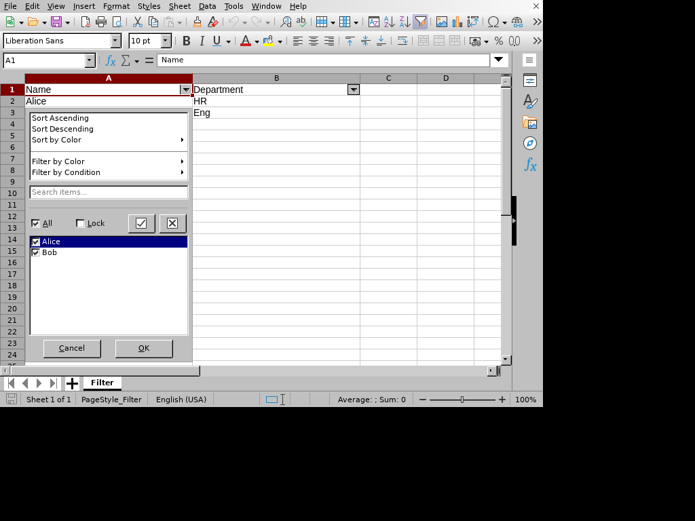</div>

### DSL Code

```ruby
# frozen_string_literal: true

require "xlsxrb"
output_path = ARGV[0] || "interactive_autofilter.xlsx"
Xlsxrb.write(output_path) do |wb|
  wb.sheet("Filter") do |s|
    s.column(0, width: 25)
    s.column(1, width: 25)
    s.row(%w[Name Department])
    s.row(%w[Alice HR])
    s.row(%w[Bob Eng])
    s.auto_filter("A1:B3")
  end
  wb.defined_name("_xlnm._FilterDatabase", "Filter!$A$1:$B$3", sheet: "Filter", hidden: true)
end
```

<hr/>

## Interactive Comments

[👉 Run and edit in Live Playground](../preview.html)

> [!TIP]
> **Interactive Feature**: This example uses interactive Excel behaviors (such as validation dropdowns, comments, or autofilters). Since the static visual preview below represents a printed page layout, open the [Live Playground](../preview.html) or download the file to interact with it.

Demonstrates cell pop-up comments. Open the sheet in Excel and hover your mouse over the cell with the red triangle to view the comment.

### Rendered Output (LibreOffice Calc)

<div></div>

<div>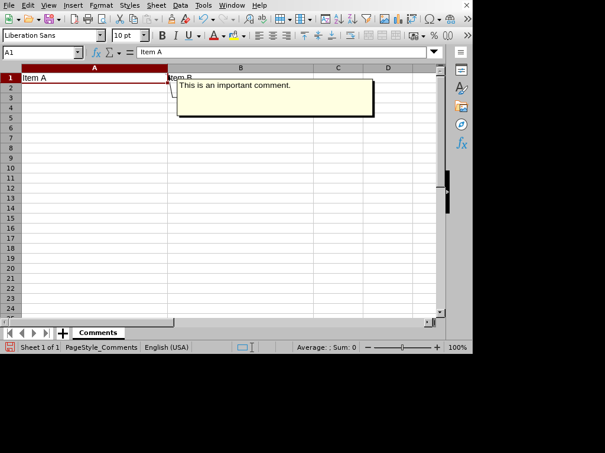</div>

### DSL Code

```ruby
# frozen_string_literal: true

require "xlsxrb"
output_path = ARGV[0] || "interactive_comments.xlsx"
Xlsxrb.write(output_path) do |wb|
  wb.sheet("Comments") do |s|
    s.column(0, width: 25)
    s.column(1, width: 25)
    s.row(["Item A", "Item B"])
    s.comment("A1", "This is an important comment.", author: "System")
  end
end
```

<hr/>

## Interactive Validation List

[👉 Run and edit in Live Playground](../preview.html)

> [!TIP]
> **Interactive Feature**: This example uses interactive Excel behaviors (such as validation dropdowns, comments, or autofilters). Since the static visual preview below represents a printed page layout, open the [Live Playground](../preview.html) or download the file to interact with it.

Demonstrates dropdown list data validations. Open the sheet in Excel and select cell A1/A2 to see the dropdown list in action.

### Rendered Output (LibreOffice Calc)

<div></div>

<div>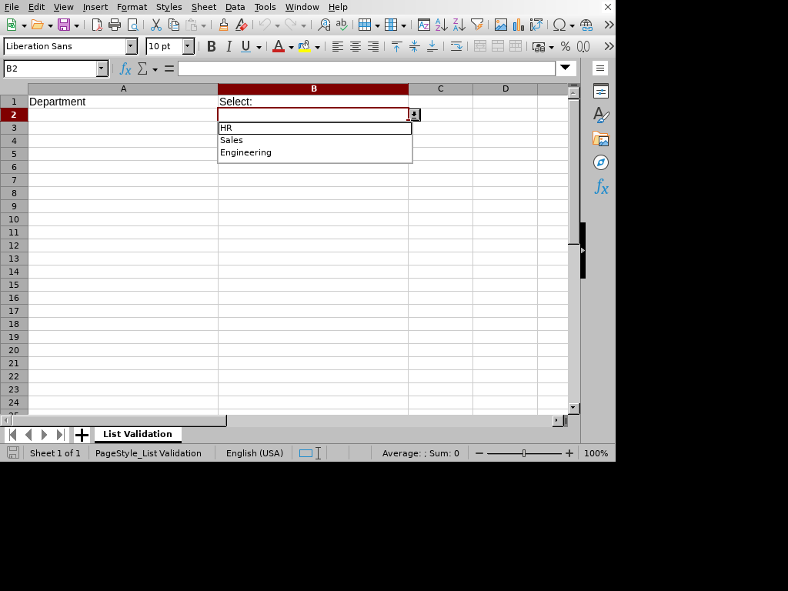</div>

### DSL Code

```ruby
# frozen_string_literal: true

require "xlsxrb"
output_path = ARGV[0] || "interactive_validation_list.xlsx"
Xlsxrb.write(output_path) do |wb|
  wb.sheet("List Validation") do |s|
    s.column(0, width: 25)
    s.column(1, width: 25)
    s.row(["Department", "Select:"])
    s.validate_data("B2", in: %w[HR Sales Engineering])
  end
end
```

<hr/>

## Interactive Validation Range

[👉 Run and edit in Live Playground](../preview.html)

> [!TIP]
> **Interactive Feature**: This example uses interactive Excel behaviors (such as validation dropdowns, comments, or autofilters). Since the static visual preview below represents a printed page layout, open the [Live Playground](../preview.html) or download the file to interact with it.

Demonstrates range constraints for whole number validations. Open the sheet in Excel and try entering a value outside 10-100 to trigger the warning.

### Rendered Output (LibreOffice Calc)

<div></div>

<div></div>

### DSL Code

```ruby
# frozen_string_literal: true

require "xlsxrb"
output_path = ARGV[0] || "interactive_validation_range.xlsx"
Xlsxrb.write(output_path) do |wb|
  wb.sheet("Range Validation") do |s|
    s.column(0, width: 25)
    s.column(1, width: 25)
    s.row(["Age", "Enter (18-99):"])
    s.validate_data("B2", type: "whole", operator: "between", formula1: "18", formula2: "99", show_error_message: true, error_title: "Invalid Age", error: "Age must be between 18 and 99!")
  end
end
```

<hr/>

## Interactive Validation Date

[👉 Run and edit in Live Playground](../preview.html)

> [!TIP]
> **Interactive Feature**: This example uses interactive Excel behaviors (such as validation dropdowns, comments, or autofilters). Since the static visual preview below represents a printed page layout, open the [Live Playground](../preview.html) or download the file to interact with it.

Demonstrates interactive date range constraints validation rules.

### Rendered Output (LibreOffice Calc)

<div></div>

<div>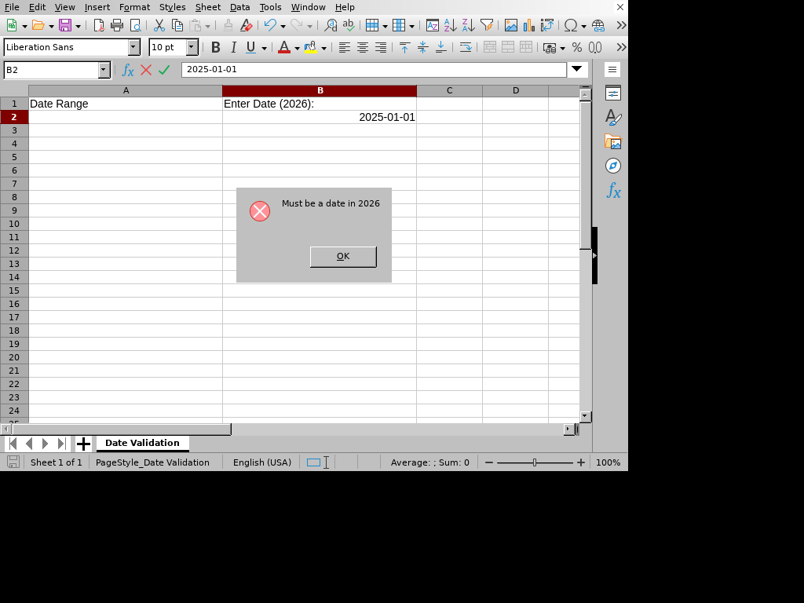</div>

### DSL Code

```ruby
# frozen_string_literal: true

require "xlsxrb"
output_path = ARGV[0] || "interactive_validation_date.xlsx"
Xlsxrb.write(output_path) do |wb|
  wb.sheet("Date Validation") do |s|
    s.column(0, width: 25)
    s.column(1, width: 25)
    s.row(["Date Range", "Enter Date (2026):"])
    s.validate_data("B2", type: "date", operator: "between", formula1: "Date(2026,1,1)", formula2: "Date(2026,12,31)", show_error_message: true, error_title: "Invalid Date", error: "Must be a date in 2026")
  end
end
```

<hr/>

## Interactive Validation Time

[👉 Run and edit in Live Playground](../preview.html)

> [!TIP]
> **Interactive Feature**: This example uses interactive Excel behaviors (such as validation dropdowns, comments, or autofilters). Since the static visual preview below represents a printed page layout, open the [Live Playground](../preview.html) or download the file to interact with it.

Demonstrates interactive time validation rules.

### Rendered Output (LibreOffice Calc)

<div></div>

<div></div>

### DSL Code

```ruby
# frozen_string_literal: true

require "xlsxrb"
output_path = ARGV[0] || "interactive_validation_time.xlsx"
Xlsxrb.write(output_path) do |wb|
  wb.sheet("Time Validation") do |s|
    s.column(0, width: 25)
    s.column(1, width: 25)
    s.row(["Schedule", "Enter Time (after 08:00):"])
    s.validate_data("B2", type: "time", operator: "greaterThan", formula1: "0.33333", show_error_message: true, error_title: "Too Early", error: "Time must be after 08:00 AM")
  end
end
```

<hr/>

## Interactive Validation Text Length

[👉 Run and edit in Live Playground](../preview.html)

> [!TIP]
> **Interactive Feature**: This example uses interactive Excel behaviors (such as validation dropdowns, comments, or autofilters). Since the static visual preview below represents a printed page layout, open the [Live Playground](../preview.html) or download the file to interact with it.

Demonstrates interactive text length validation rules.

### Rendered Output (LibreOffice Calc)

<div></div>

<div>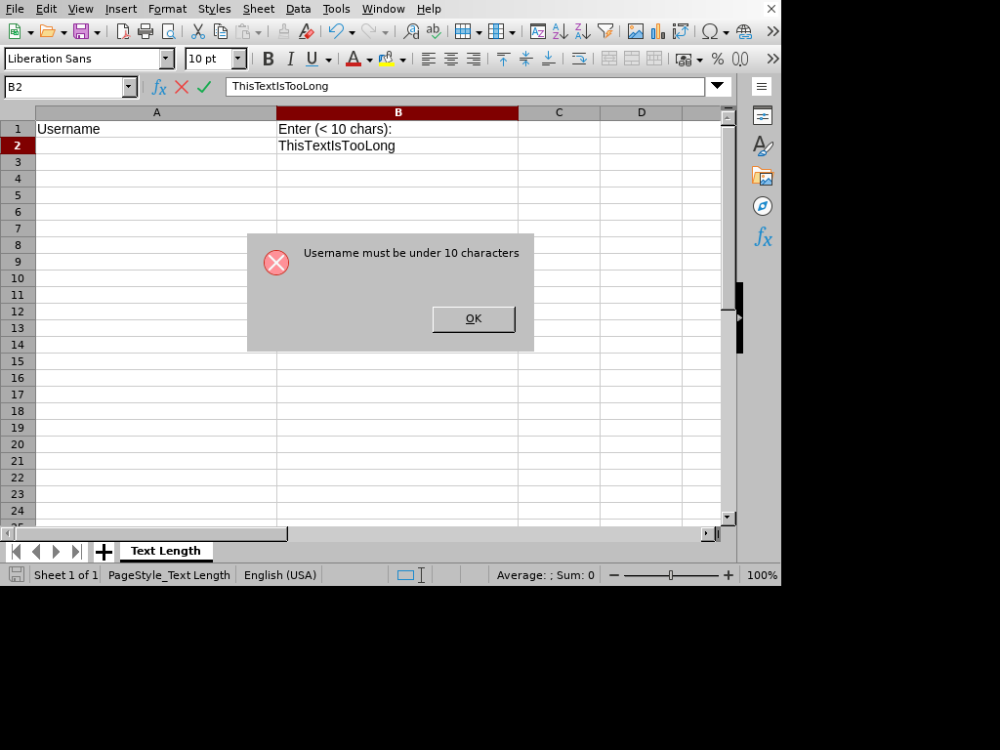</div>

### DSL Code

```ruby
# frozen_string_literal: true

require "xlsxrb"
output_path = ARGV[0] || "interactive_validation_text_length.xlsx"
Xlsxrb.write(output_path) do |wb|
  wb.sheet("Text Length") do |s|
    s.column(0, width: 25)
    s.column(1, width: 25)
    s.row(["Username", "Enter (< 10 chars):"])
    s.validate_data("B2", type: "textLength", operator: "lessThan", formula1: "10", show_error_message: true, error_title: "Too Long", error: "Username must be under 10 characters")
  end
end
```

<hr/>

## Interactive Validation Custom

[👉 Run and edit in Live Playground](../preview.html)

> [!TIP]
> **Interactive Feature**: This example uses interactive Excel behaviors (such as validation dropdowns, comments, or autofilters). Since the static visual preview below represents a printed page layout, open the [Live Playground](../preview.html) or download the file to interact with it.

Demonstrates interactive custom formula validation rules.

### Rendered Output (LibreOffice Calc)

<div></div>

<div>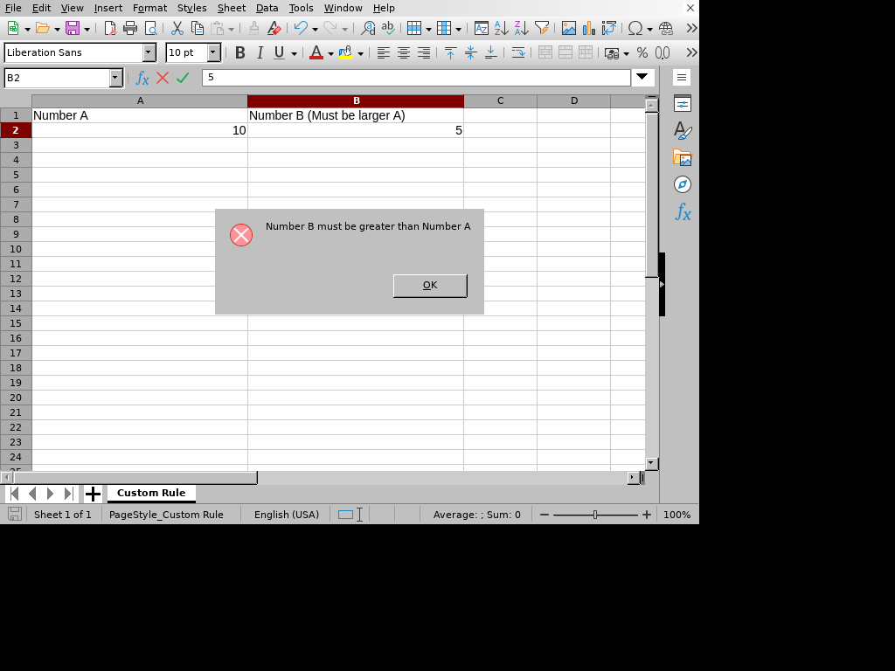</div>

### DSL Code

```ruby
# frozen_string_literal: true

require "xlsxrb"
output_path = ARGV[0] || "interactive_validation_custom.xlsx"
Xlsxrb.write(output_path) do |wb|
  wb.sheet("Custom Rule") do |s|
    s.column(0, width: 25)
    s.column(1, width: 25)
    s.row(["Number A", "Number B (Must be larger A)"])
    s.row([10, ""])
    s.validate_data("B2", type: "custom", formula1: "B2>A2", show_error_message: true, error_title: "Validation Error", error: "Number B must be greater than Number A")
  end
end
```

<hr/>

## View Show Grid Lines

[👉 Run and edit in Live Playground](../preview.html)

Demonstrates disabling visible grid lines in spreadsheet view.

### Rendered Output (LibreOffice Calc)

<div></div>

### DSL Code

```ruby
# frozen_string_literal: true

require "xlsxrb"
output_path = ARGV[0] || "view_show_grid_lines.xlsx"
Xlsxrb.write(output_path) do |wb|
  wb.sheet("Hide Grid Lines") do |s|
    s.column(0, width: 25)
    s.column(1, width: 25)
    s.sheet_view(:show_grid_lines, false)
    s.row(["No Grid Lines displayed"])
  end
end
```

<hr/>

## View Zoom Scale

[👉 Run and edit in Live Playground](../preview.html)

Demonstrates setting custom zoom scale in sheet view (e.g. 150%).

### Rendered Output (LibreOffice Calc)

<div></div>

### DSL Code

```ruby
# frozen_string_literal: true

require "xlsxrb"
output_path = ARGV[0] || "view_zoom_scale.xlsx"
Xlsxrb.write(output_path) do |wb|
  wb.sheet("Zoom 150") do |s|
    s.column(0, width: 25)
    s.column(1, width: 25)
    s.sheet_view(:zoom_scale, 150)
    s.row(["Zoom scale is set to 150%"])
  end
end
```

<hr/>

## Workbook Three Sheets

[👉 Run and edit in Live Playground](../preview.html)

Demonstrates creating workbooks with multiple worksheets.

### Rendered Output (LibreOffice Calc)

<div></div>

<div></div>

<div></div>

### DSL Code

```ruby
# frozen_string_literal: true

require "xlsxrb"
output_path = ARGV[0] || "workbook_three_sheets.xlsx"
Xlsxrb.write(output_path) do |wb|
  wb.sheet("First Sheet") { |s| s.row(["First Sheet Data"]) }
  wb.sheet("Second Sheet") { |s| s.row(["Second Sheet Data"]) }
  wb.sheet("Third Sheet") { |s| s.row(["Third Sheet Data"]) }
end
```

<hr/>

